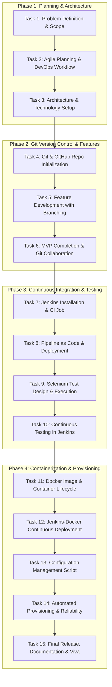

# Task 1: Problem Definition and Scope
## Project: Git-Based Farmer Training Registration Platform

---

### 1. Executive Summary & Real-Time Need
Modern agricultural advancement relies heavily on continuous education and capacity building for farmers. Agricultural Extension Centers, Krishi Vigyan Kendras (KVKs), State Agricultural Departments, and Non-Governmental Organizations (NGOs) regularly organize hands-on training sessions covering organic farming, micro-irrigation techniques, integrated pest management, high-yield seed varieties, and drone-based spraying.

However, the current administrative operations for farmer registrations are predominantly paper-based, informal (via ad-hoc phone calls or spreadsheets), or fragmented across disparate regional offices. This creates substantial operational bottlenecks:
- Farmers travel long distances without guaranteed seat availability or prior confirmation.
- Training coordinators struggle with inaccurate participant counts, leading to misallocation of training kits, farm machinery, seeds, and refreshments.
- Lack of centralized records makes it impossible to verify farmer attendance, track eligibility for subsequent subsidy programs, or prevent duplicate entries across multiple batches.

The **Git-Based Farmer Training Registration Platform** addresses these challenges by offering a lightweight, reliable, and transparent registration, approval, and tracking system built with a DevOps-first mindset—enabling continuous integration, automated testing, and repeatable deployments.

---

### 2. Problem Statement
> **"Agricultural training institutes and extension departments lack an integrated, automated, and auditable registration platform. This causes administrative overhead, high registration drop-off, duplicate applicant records, and lack of real-time confirmation for rural farmers."**

#### Key Challenges in the Current Setup:
1. **Manual & Fragmented Data Collection:** Paper logs or phone registrations cause transcription errors and lost records.
2. **Zero Real-Time Tracking for Farmers:** Once a farmer submits their interest, they receive no real-time status updates (Pending, Approved, Waitlisted, Confirmed).
3. **Logistical Inefficiencies:** Trainers cannot predict batch sizes accurately, leading to wasted resources or overcrowded workshops.
4. **Data Integrity & Duplication:** No automated validation to prevent the same national identity/phone number from booking duplicate seats in the same batch.
5. **Slow Deployment & Fragile Releases:** Traditional administrative software updates are manual, prone to environment inconsistencies, and lack automated testing or version control.

---

### 3. Target Users & Personas

| User Persona | Role & Context | Primary Goals | Key Pain Points |
| :--- | :--- | :--- | :--- |
| **Ramesh (Farmer / Registrant)** | Smallholder farmer with smartphone access or local kiosk assistance. | Register quickly for relevant farming workshops; check confirmation status anytime. | Complicated forms, long wait times, no status updates after submitting request. |
| **Anil (Agricultural Extension Officer)** | Field agent assisting rural farmers in villages. | Register multiple farmers in bulk or on behalf of illiterate farmers; monitor village quota. | Unreliable connectivity, cumbersome paperwork, manual data re-entry. |
| **Dr. Sunita (Training Coordinator / KVK)** | Trainer organizing weekly capacity building workshops. | View incoming applications, review farmer eligibility, approve/reject candidates, cap batch size. | Unexpected walk-ins, food/material wastage, lack of structured attendee lists. |
| **Platform Administrator / DevOps Engineer** | IT & DevOps team maintaining application stability and deployment pipelines. | Ensure automated builds, 99.9% uptime, zero regression releases, Git-tracked changes. | Manual server deployments, lack of CI/CD, untracked configuration drifts. |

---

### 4. Stakeholder Matrix

| Stakeholder Category | Stakeholders | Expectations / Value Delivered | Influence / Interest |
| :--- | :--- | :--- | :--- |
| **Primary Beneficiaries** | Farmers & Farming Communities | Simple registration, instant application tracking, transparent confirmation. | High Interest / Medium Influence |
| **Operational Users** | Extension Officers, KVK Trainers, Reviewers | Real-time participant dashboards, one-click approvals, automated attendance sheets. | High Interest / High Influence |
| **Governing Bodies** | Department of Agriculture, Program Sponsors | Accurate reporting, verified training reach, audit-ready digital trail. | Medium Interest / High Influence |
| **Technical Owners** | DevOps Engineers, Developers, System Admins | Clean Git workflows, modular micro/monolith architecture, automated CI/CD pipeline. | High Interest / High Influence |

---

### 5. Objectives & Measurable Success Criteria

#### Project Objectives:
1. Provide an intuitive, low-friction web portal for farmers and extension officers to register for upcoming training modules.
2. Implement automated business validation to eliminate duplicate registrations and invalid contact details.
3. Establish a streamlined approval workflow allowing training coordinators to review, confirm, or reject applications with auditable timestamps.
4. Provide a self-service status tracking mechanism for farmers using their unique Registration ID or Mobile Number.
5. Engineer the system with modern DevOps practices: Git version control, automated Maven builds, unit testing, Docker containerization, and automated deployment.

#### Measurable Success Criteria (KPIs):

| Metric | Baseline (Manual System) | Target (Git-Based MVP) |
| :--- | :--- | :--- |
| **Registration Time** | 10–15 minutes (paper + travel) | < 2 minutes on web portal |
| **Status Confirmation** | 3–7 business days | Instant submission acknowledgment + real-time status lookup |
| **Duplicate Registrations** | 12%–18% duplication rate | **0%** (enforced by phone + training ID unique constraints) |
| **Admin Processing Effort** | 4–6 hours per batch | < 15 minutes per batch with digital approval console |
| **DevOps Build & Test Time** | Manual deployment (hours) | **< 3 minutes** automated build and test pipeline |
| **System Availability** | Dependent on office hours | **99.9% uptime** with health check monitoring |

---

### 6. Project Constraints
1. **Technical Constraints:**
   - Must run on standard Java 21 LTS runtime with Apache Maven.
   - Low bandwidth footprint for rural networks; minimal client-side dependencies.
   - Zero external infrastructure dependency for local development (embedded H2 database with automatic schema generation).
2. **Operational Constraints:**
   - Single-command build and test (`mvn clean test`).
   - Container-ready packaging for local and cloud environments.
3. **Data Security & Privacy:**
   - Masking sensitive personal data in logs.
   - Strict input sanitization against XSS and SQL injection.

---

### 7. Approved 15-Task MVP Scope Breakdown

To ensure a disciplined, industry-grade DevOps execution, the project is structured into a frozen 15-task development lifecycle:

#### Detailed 15-Task Matrix (Academic Syllabus Alignment):
- **Task 1: Problem Definition and Scope:** Study real-time need, target users, pain points, stakeholders, constraints, success criteria, and freeze 15-Task MVP scope. *(Completed)*
- **Task 2: Agile Planning and DevOps Workflow:** User stories, Gherkin acceptance criteria, product backlog, 15-Task Kanban/Scrum plan, Definition of Done, and DevOps lifecycle diagram. *(Completed)*
- **Task 3: Requirements, Architecture and Technology Setup:** SRS summary, use-case diagram, architecture diagram, data model/API list, and working local setup (Java 21, Spring Boot, Maven, H2, Tomcat). *(Completed)*
- **Task 4: Git and GitHub Repository Initialization:** Create GitHub repository, add README, `.gitignore`, folder structure, issue templates, branch naming rules, initial commits, and branch policy. *(Completed)*
- **Task 5: Feature Development with Branching:** Implement the first core workflow on a feature branch (`feature/registration-workflow`). Use add, commit, push, pull, logs, pull request, review, and merge.
- **Task 6: MVP Completion and Git Collaboration:** Implement remaining MVP functions (validation, approval/confirmation, participant listing, status tracking), demonstrate conflict creation/resolution, and version tagging.
- **Task 7: Jenkins Installation and Continuous Integration Job:** Configure Jenkins, connect GitHub repo, create Maven build job triggered by commit/polling, archive build artifact.
- **Task 8: Pipeline as Code and Server Deployment:** Create Jenkinsfile with checkout, build, package, and deploy stages. Deploy build to Tomcat/Nginx and parameterize environment settings.
- **Task 9: Selenium Test Design and Local Execution:** Identify 3-5 critical user journeys, write Selenium WebDriver test cases with assertions, and execute locally via Maven.
- **Task 10: Continuous Testing in Jenkins:** Integrate Selenium suite into Jenkins, publish test reports, configure pipeline quality gate, correct deliberately introduced defect.
- **Task 11: Docker Image and Container Lifecycle:** Create Dockerfile, build/tag image, run container, map ports, inspect logs, manage container lifecycle.
- **Task 12: Jenkins-Docker Continuous Deployment:** Extend Jenkins pipeline to build versioned Docker image, publish to registry, deploy container automatically after tests.
- **Task 13: Configuration Management Script:** Identify server prerequisites (packages, users, folders, ports), create Ansible playbook or Puppet manifest.
- **Task 14: Automated Provisioning and Reliability Validation:** Provision target environment using Ansible/Puppet, deploy application, demonstrate idempotency, healthcheck, and rollback.
- **Task 15: Final End-to-End Release, Documentation and Viva:** Execute end-to-end DevOps workflow (Git ➔ Jenkins ➔ Selenium ➔ Docker ➔ Ansible), technical documentation, presentation, and viva.

---
*Deliverable Status: Approved & Frozen.*
