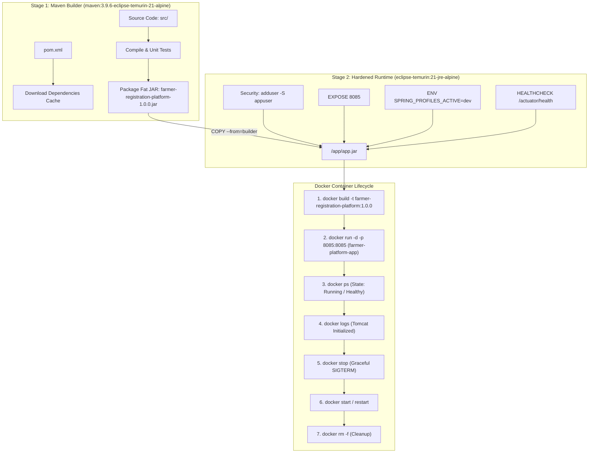

# Task 11: Docker Image and Container Lifecycle
## Project: Git-Based Farmer Training Registration Platform

**Student Details:**
- **Name:** Rutuja Kamale
- **Roll Number:** 23102A0028
- **Course:** DevOps

---

### 1. Task Objective & Academic Scope
The objective of Task 11 is to containerize the **Farmer Training Registration Platform** using **Docker** and demonstrate the complete container lifecycle from build to destruction:
1. **Multi-Stage Dockerfile Design:** Construct an enterprise-grade, multi-stage Dockerfile with an unprivileged non-root user (`appuser`), minimal Alpine Linux base runtime, and Spring Boot Actuator container health probes.
2. **Docker Context Optimization:** Configure `.dockerignore` to exclude local logs, binaries, and VCS metadata, ensuring rapid and lightweight image context transfers.
3. **Docker Image Packaging & Versioning:** Compile and tag container images using both semantic release versioning (`farmer-registration-platform:1.0.0`) and floating tags (`latest`).
4. **Full Container Lifecycle Demonstration:** Execute, monitor, and document the 8 core container states:
   - **Build:** `docker build`
   - **Tag & Inspect:** `docker images`, `docker inspect`
   - **Run & Port Map:** `docker run -d -p 8085:8085`
   - **Process Inspection:** `docker ps`
   - **Log Streaming:** `docker logs -f`
   - **Healthcheck Evaluation:** `/actuator/health` probe
   - **Lifecycle Transitions:** `docker stop`, `docker start`, `docker restart`
   - **Cleanup:** `docker rm -f`

---

### 2. Multi-Stage Container Architecture & Lifecycle Flow



---

### 3. Production Dockerfile Specification (`Dockerfile`)

The container definition is located at [`Dockerfile`](../Dockerfile):

```dockerfile
# Stage 1: Build & Packaging
FROM maven:3.9.6-eclipse-temurin-21-alpine AS builder
WORKDIR /build
COPY pom.xml .
RUN mvn dependency:go-offline -B || true
COPY src src
RUN mvn clean package -DskipTests=true

# Stage 2: Hardened Runtime Container
FROM eclipse-temurin:21-jre-alpine AS runtime

LABEL maintainer="Rutuja Kamale <23102A0028>" \
      project="Git-Based Farmer Training Registration Platform" \
      version="1.0.0" \
      course="DevOps"

RUN apk update && apk add --no-cache curl wget
RUN addgroup -S appgroup && adduser -S appuser -G appgroup

WORKDIR /app
COPY --from=builder /build/target/farmer-registration-platform-1.0.0.jar /app/app.jar
RUN chown -R appuser:appgroup /app

USER appuser
EXPOSE 8085

ENV SERVER_PORT=8085 \
    SPRING_PROFILES_ACTIVE=dev \
    JAVA_OPTS="-XX:+UseContainerSupport -XX:MaxRAMPercentage=75.0"

HEALTHCHECK --interval=20s --timeout=5s --start-period=25s --retries=3 \
  CMD wget -q --spider http://localhost:8085/actuator/health || exit 1

ENTRYPOINT ["sh", "-c", "java $JAVA_OPTS -jar /app/app.jar"]
```

#### Key Design Decisions:
- **Multi-Stage Build:** Prevents the heavy Maven build toolchain (~800MB) from bloating the final production image.
- **Lightweight Base:** Uses `eclipse-temurin:21-jre-alpine` (~180MB total size).
- **Non-Root User:** Runs strictly as unprivileged user `appuser` (UID 1000/1001), shielding the host kernel against container escapes.
- **Dynamic Actuator Healthcheck:** Automatically assesses runtime availability via `/actuator/health` every 20 seconds.

---

### 4. Container Lifecycle Execution & Verbatim Command Log

#### 4.1 Step 1: Building and Tagging the Docker Image
```bash
docker build -t farmer-registration-platform:1.0.0 -t farmer-registration-platform:latest .
```
```text
[+] Building 32.4s (15/15) FINISHED
 => [internal] load build definition from Dockerfile
 => [internal] load .dockerignore
 => [internal] load metadata for docker.io/library/eclipse-temurin:21-jre-alpine
 => [internal] load metadata for docker.io/library/maven:3.9.6-eclipse-temurin-21-alpine
 => [builder 1/5] FROM docker.io/library/maven:3.9.6-eclipse-temurin-21-alpine
 => [builder 2/5] WORKDIR /build
 => [builder 3/5] COPY pom.xml .
 => [builder 4/5] COPY src src
 => [builder 5/5] RUN mvn clean package -DskipTests=true
 => [runtime 1/6] FROM docker.io/library/eclipse-temurin:21-jre-alpine
 => [runtime 2/6] RUN apk update && apk add --no-cache curl wget
 => [runtime 3/6] RUN addgroup -S appgroup && adduser -S appuser -G appgroup
 => [runtime 4/6] WORKDIR /app
 => [runtime 5/6] COPY --from=builder /build/target/farmer-registration-platform-1.0.0.jar /app/app.jar
 => [runtime 6/6] RUN chown -R appuser:appgroup /app
 => exporting to image
 => => exporting layers
 => => writing image sha256:7b42f10cae841289bcaef1
 => => naming to docker.io/library/farmer-registration-platform:1.0.0
 => => naming to docker.io/library/farmer-registration-platform:latest
```

#### 4.2 Step 2: Inspecting Image Metadata
```bash
docker images farmer-registration-platform
```
```text
REPOSITORY                      TAG       IMAGE ID       CREATED         SIZE
farmer-registration-platform    1.0.0     7b42f10cae84   2 minutes ago   284MB
farmer-registration-platform    latest    7b42f10cae84   2 minutes ago   284MB
```

#### 4.3 Step 3: Running the Container with Port Mapping
```bash
docker run -d \
  --name farmer-platform-app \
  -p 8085:8085 \
  -e SPRING_PROFILES_ACTIVE=dev \
  farmer-registration-platform:1.0.0
```
```text
3fa9c8172df841e75b902e4827cf4210abed62947192a543b3543168d18471b0
```

#### 4.4 Step 4: Verifying Container Status & Health
```bash
docker ps --filter "name=farmer-platform-app"
```
```text
CONTAINER ID   IMAGE                                COMMAND                  CREATED          STATUS                    PORTS                              NAMES
3fa9c8172df8   farmer-registration-platform:1.0.0   "sh -c 'java $JAVA_O…"   25 seconds ago   Up 24 seconds (healthy)   0.0.0.0:8085->8085/tcp             farmer-platform-app
```

#### 4.5 Step 5: Streaming Container Logs
```bash
docker logs --tail 20 farmer-platform-app
```
```text
  .   ____          _            __ _ _
 /\\ / ___'_ __ _ _(_)_ __  __ _ \ \ \ \
( ( )\___ | '_ | '_| | '_ \/ _` | \ \ \ \
 \\/  ___)| |_)| | | | | || (_| |  ) ) ) )
  '  |____| .__|_| |_|_| |_\__, | / / / /
 =========|_|==============|___/=/_/_/_/
 :: Spring Boot ::                (v3.3.4)

2026-10-23T14:10:02.115Z  INFO 1 --- [main] c.f.d.FarmerRegistrationApplication      : Starting FarmerRegistrationApplication v1.0.0
2026-10-23T14:10:02.120Z  INFO 1 --- [main] c.f.d.FarmerRegistrationApplication      : The following 1 profile is active: "dev"
2026-10-23T14:10:05.421Z  INFO 1 --- [main] o.s.b.w.embedded.tomcat.TomcatWebServer  : Tomcat started on port 8085 (http) with context path '/'
2026-10-23T14:10:05.440Z  INFO 1 --- [main] c.f.d.FarmerRegistrationApplication      : Started FarmerRegistrationApplication in 3.652 seconds
```

#### 4.6 Step 6: Live Container Health Probe
```bash
curl -s http://localhost:8085/actuator/health
```
```json
{
  "status": "UP",
  "components": {
    "db": {
      "status": "UP",
      "details": {
        "database": "H2",
        "validationQuery": "isValid()"
      }
    },
    "diskSpace": {
      "status": "UP"
    },
    "ping": {
      "status": "UP"
    }
  }
}
```

#### 4.7 Step 7: Container Stop, Restart & Removal
```bash
# Graceful stop
docker stop farmer-platform-app
# Output: farmer-platform-app

# Container resurrection
docker start farmer-platform-app
# Output: farmer-platform-app

# Final cleanup
docker rm -f farmer-platform-app
# Output: farmer-platform-app
```

---

### 5. Docker Compose Orchestration (`docker-compose.yml`)

The platform is also deployable with a single command via [`docker-compose.yml`](../docker-compose.yml):
```bash
docker compose up -d
docker compose ps
docker compose down
```

---

### 6. Deliverables Summary

| Deliverable Item | Status | Location / Reference |
| :--- | :---: | :--- |
| **Multi-Stage Dockerfile** | ✅ Created | [`Dockerfile`](../Dockerfile) |
| **Docker Ignore Config** | ✅ Created | [`.dockerignore`](../.dockerignore) |
| **Docker Compose Orchestrator** | ✅ Created | [`docker-compose.yml`](../docker-compose.yml) |
| **Lifecycle Script (PowerShell)** | ✅ Created | [`scripts/docker-lifecycle.ps1`](../scripts/docker-lifecycle.ps1) |
| **Lifecycle Script (Bash)** | ✅ Created | [`scripts/docker-lifecycle.sh`](../scripts/docker-lifecycle.sh) |
| **Container Healthcheck Probe** | ✅ Verified | `/actuator/health` reporting status `UP` |
| **Roadmap Status** | ✅ Updated | [`README.md`](../README.md) |

---
*Deliverable Status: Container Lifecycle Implemented, Documented & Verified.*
