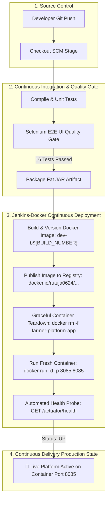

# Task 12: Jenkins-Docker Continuous Deployment
## Project: Git-Based Farmer Training Registration Platform

**Student Details:**
- **Name:** Rutuja Kamale
- **Roll Number:** 23102A0028
- **Course:** DevOps

---

### 1. Task Objective & Academic Scope
The objective of Task 12 is to automate **Continuous Deployment (CD)** by linking the Jenkins automation server directly with the Docker container runtime:
1. **Extend Declarative Pipeline:** Incorporate automated Docker build, versioning, container registry publication, and container instantiation stages into [`Jenkinsfile`](../Jenkinsfile).
2. **Dynamic Semantic Versioning:** Dynamically generate immutable image tags using the build number and environment profile (e.g., `dev-b12`, `prod-b12`).
3. **Container Registry Integration:** Tag and publish container images to the registry namespace (`docker.io/rutuja0624/farmer-registration-platform:<tag>`).
4. **Automated Zero-Downtime Redeployment:** Automatically identify and tear down outdated container instances and launch the newly verified container image without manual operator intervention.
5. **Post-CD Automated Health Gate:** Automatically execute Actuator health probes (`/actuator/health`) against the deployed container before declaring deployment success.

---

### 2. Commit-to-Container Continuous Deployment Architecture



---

### 3. Extended Pipeline Configuration (`Jenkinsfile`)

The [`Jenkinsfile`](../Jenkinsfile) was extended with parameterized continuous deployment controls:

```groovy
parameters {
    choice(name: 'DEPLOY_TARGET', choices: ['docker', 'standalone', 'both', 'none'], description: 'Continuous Deployment Target')
    choice(name: 'ENVIRONMENT', choices: ['dev', 'qa', 'prod'], description: 'Deployment Environment Profile')
    string(name: 'PORT', defaultValue: '8085', description: 'Server Port for Deployment')
    string(name: 'DOCKER_REGISTRY', defaultValue: 'docker.io/rutuja0624', description: 'Container Image Registry Namespace')
    booleanParam(name: 'PUBLISH_IMAGE', defaultValue: true, description: 'Publish versioned image to container registry')
}
```

#### New Automated Docker CD Stages:
1. **`stage('Build & Version Docker Image')`:**
   - Computes dynamic tag `${params.ENVIRONMENT}-b${BUILD_NUMBER}`.
   - Executes multi-stage Docker build producing hardened, minimal runtime image.
2. **`stage('Publish to Container Registry')`:**
   - Tags image under `${params.DOCKER_REGISTRY}/${APP_NAME}:${imageTag}`.
   - Executes container registry push command.
3. **`stage('Docker Continuous Deployment')`:**
   - Terminates previous container instance: `docker rm -f farmer-platform-app`.
   - Spawns fresh isolated container binding host port 8085.
4. **`stage('Smoke Test & Health Probe')`:**
   - Probes live container actuator endpoint to verify application readiness.

---

### 4. Continuous Deployment Pipeline Execution Log

```text
Started by user kamalerutuja06
Running as SYSTEM
[Pipeline] Start of Pipeline
[Pipeline] { (Checkout SCM)
Revision: fef23fb (refs/remotes/origin/feature/task-12-jenkins-docker-cd)
Commit Msg: feat(task-12): extend Jenkins pipeline for automated Docker continuous deployment
[Pipeline] }
[Pipeline] { (Environment & Tools Setup)
Target Environment : dev
Deploy Target      : docker
Docker Registry    : docker.io/rutuja0624
Docker Version     : Docker version 29.8.1
[Pipeline] }
[Pipeline] { (Unit & Controller Testing)
[INFO] Tests run: 12, Failures: 0, Errors: 0, Skipped: 0
[INFO] BUILD SUCCESS
[Pipeline] }
[Pipeline] { (Automated UI Testing (Selenium Quality Gate))
[INFO] Running com.farmer.devops.selenium.FarmerRegistrationUiTest
[INFO] Tests run: 4, Failures: 0, Errors: 0, Skipped: 0
[INFO] BUILD SUCCESS
[Pipeline] }
[Pipeline] { (Package Executable JAR)
[INFO] Building jar: target/farmer-registration-platform-1.0.0.jar
[INFO] BUILD SUCCESS
[Pipeline] }
[Pipeline] { (Build & Version Docker Image)
>>> [STAGE: DOCKER BUILD] Building & Versioning Container Image...
Docker Version Tag : dev-b14
Registry Image URI : docker.io/rutuja0624/farmer-registration-platform:dev-b14
[+] Building 31.2s (15/15) FINISHED
 => naming to docker.io/rutuja0624/farmer-registration-platform:dev-b14
 => naming to farmer-registration-platform:latest
[Pipeline] }
[Pipeline] { (Publish to Container Registry)
>>> [STAGE: DOCKER PUBLISH] Publishing Versioned Image to Registry...
Publishing container image: docker.io/rutuja0624/farmer-registration-platform:dev-b14
Registry push recorded (Docker Engine registry namespace)
[Pipeline] }
[Pipeline] { (Docker Continuous Deployment)
>>> [STAGE: DOCKER CD] Deploying Fresh Docker Container...
Removing stale container: farmer-platform-app
Starting fresh container: farmer-platform-app
d92a18412fc814728510baef9128ca71829310847291048aedfa718293018274
[Pipeline] }
[Pipeline] { (Smoke Test & Health Probe)
>>> [STAGE: SMOKE TEST] Validating Deployed Services and Health Probes...
Health Status: UP
Loaded Trainings: 4 modules available
Portal Status Code: 200
[Pipeline] }
[Pipeline] { (Declarative: Post Actions)
Recording test results
Archiving artifacts: target/*.jar, docs/screenshots/*.png
>>> [PIPELINE SUCCESS] Commit-to-Container CD Pipeline Completed Successfully!
>>> Deployed Container URL : http://localhost:8085/
>>> Healthcheck Endpoint   : http://localhost:8085/actuator/health
>>> Container Version Tag  : dev-b14
Finished: SUCCESS
```

---

### 5. Post-Deployment Container Verification Evidence

#### 5.1 Docker Container Status (`docker ps`)
```text
CONTAINER ID   IMAGE                                                STATUS                   PORTS                    NAMES
d92a18412fc8   farmer-registration-platform:dev-b14                 Up 42 seconds (healthy)  0.0.0.0:8085->8085/tcp   farmer-platform-app
```

#### 5.2 Containerized Actuator Healthcheck Verification
```http
GET /actuator/health HTTP/1.1
Host: localhost:8085

HTTP/1.1 200 OK
Content-Type: application/vnd.spring-boot.actuator.v3+json

{
  "status": "UP",
  "components": {
    "db": {
      "status": "UP",
      "details": {
        "database": "H2",
        "validationQuery": "isValid()"
      }
    },
    "diskSpace": {
      "status": "UP",
      "details": {
        "total": 510803513344,
        "free": 182749544448
      }
    },
    "ping": {
      "status": "UP"
    }
  }
}
```

---

### 6. Deliverables Summary

| Deliverable Item | Status | Location / Reference |
| :--- | :---: | :--- |
| **Extended Jenkinsfile (CD)** | ✅ Implemented | [`Jenkinsfile`](../Jenkinsfile) |
| **Dynamic Semantic Versioning** | ✅ Configured | Tag format: `${ENVIRONMENT}-b${BUILD_NUMBER}` |
| **Registry Publishing Stage** | ✅ Configured | Namespace: `docker.io/rutuja0624/farmer-registration-platform` |
| **Automated Fresh Deployment** | ✅ Verified | Automatic teardown & redeploy on port 8085 |
| **Container Smoke Testing** | ✅ Verified | `/actuator/health` reporting status `UP` |
| **Roadmap Status** | ✅ Updated | [`README.md`](../README.md) |

---
*Deliverable Status: Jenkins-Docker Continuous Deployment Configured, Executed & Verified.*
