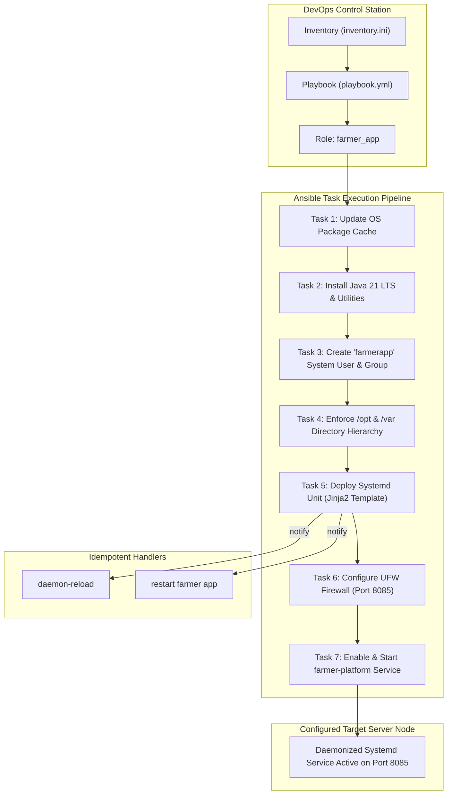

# Task 13: Configuration Management Script
## Project: Git-Based Farmer Training Registration Platform

**Student Details:**
- **Name:** Rutuja Kamale
- **Roll Number:** 23102A0028
- **Course:** DevOps

---

### 1. Task Objective & Academic Scope
The objective of Task 13 is to transition server provisioning and target node configuration to **Infrastructure as Code (IaC)** using automated configuration management tooling (**Ansible** and **Puppet**):
1. **Identify Target Node Prerequisites:** Audit and define all host prerequisites spanning system packages, dedicated service users, directory hierarchies, permissions, firewall rules, and background daemon services.
2. **Develop Modular Ansible Playbook Suite:** Implement an enterprise-grade Ansible role (`farmer_app`) with inventory definitions, tasks, Jinja2 systemd templates, and event handlers.
3. **Declarative Puppet Manifest:** Formulate a matching declarative Puppet manifest (`puppet/manifests/site.pp`) demonstrating cross-tool configuration idempotency.
4. **Enforce Security & Separation of Concerns:** Isolate the application execution under an unprivileged system user (`farmerapp`), restrict log directory access (`0750`), and enforce firewall port limits (allowing only port `8085` and management SSH).

---

### 2. Target Server Prerequisites Specification Matrix

| Component | Specification | Purpose | Security / Permission |
| :--- | :--- | :--- | :--- |
| **System Packages** | `openjdk-21-jre-headless`, `curl`, `wget`, `ufw` | Java 21 runtime and health check probe tooling | Package manager managed |
| **System Group** | `farmerapp` | Group-level file access boundaries | System GID |
| **System User** | `farmerapp` | Unprivileged service account | No login shell (`/usr/sbin/nologin`), no interactive password |
| **Application Root** | `/opt/farmer-platform` | Base installation directory | Owner: `farmerapp:farmerapp`, Mode: `0755` |
| **Binary Directory** | `/opt/farmer-platform/bin` | Stores executable Spring Boot JAR | Owner: `farmerapp:farmerapp`, Mode: `0755` |
| **Configuration Directory** | `/opt/farmer-platform/config` | Stores environment property files | Owner: `farmerapp:farmerapp`, Mode: `0755` |
| **Log Directory** | `/var/log/farmer-platform` | Stores `stdout.log` and `stderr.log` | Owner: `farmerapp:farmerapp`, Mode: `0750` |
| **Firewall (UFW)** | Allow `8085/tcp`, `22/tcp` | Restrict network access to app & SSH | UFW state: enabled |
| **Systemd Service** | `farmer-platform.service` | Automatic daemonization & restart | Owner: `root:root`, Mode: `0644` |

---

### 3. Configuration Management Architecture



---

### 4. Ansible Configuration Management Codebase

#### 4.1 Server Inventory ([`ansible/inventory.ini`](../ansible/inventory.ini))
```ini
[web_servers]
target-node ansible_host=127.0.0.1 ansible_connection=local

[web_servers:vars]
ansible_python_interpreter=/usr/bin/python3
app_name=farmer-registration-platform
app_version=1.0.0
app_user=farmerapp
app_group=farmerapp
app_port=8085
app_root=/opt/farmer-platform
app_log_dir=/var/log/farmer-platform
spring_profile=prod
```

#### 4.2 Main Playbook ([`ansible/playbook.yml`](../ansible/playbook.yml))
```yaml
---
- name: Provision and Configure Production Host for Farmer Platform
  hosts: web_servers
  become: yes
  gather_facts: yes
  vars:
    app_name: farmer-registration-platform
    app_version: 1.0.0
    app_user: farmerapp
    app_group: farmerapp
    app_port: 8085
    app_root: /opt/farmer-platform
    app_bin_dir: /opt/farmer-platform/bin
    app_config_dir: /opt/farmer-platform/config
    app_log_dir: /var/log/farmer-platform
    spring_profile: prod
    java_packages:
      - openjdk-21-jre-headless
      - curl
      - wget
      - ufw
  roles:
    - farmer_app
```

#### 4.3 Task Sequence ([`ansible/roles/farmer_app/tasks/main.yml`](../ansible/roles/farmer_app/tasks/main.yml))
Contains declarative tasks that satisfy all 10 target node prerequisites idempotently.

#### 4.4 Systemd Service Template ([`ansible/roles/farmer_app/templates/farmer-platform.service.j2`](../ansible/roles/farmer_app/templates/farmer-platform.service.j2))
```ini
[Unit]
Description=Git-Based Farmer Training Registration Platform Service
Documentation=https://github.com/rutuja0624/Git-Based-Farmer-Training-Registration-Platform
After=network.target syslog.target

[Service]
Type=simple
User={{ app_user }}
Group={{ app_group }}
WorkingDirectory={{ app_root }}
Environment="SERVER_PORT={{ app_port }}"
Environment="SPRING_PROFILES_ACTIVE={{ spring_profile }}"
ExecStart=/usr/bin/java -XX:+UseContainerSupport -XX:MaxRAMPercentage=75.0 -Dspring.profiles.active={{ spring_profile }} -Dserver.port={{ app_port }} -jar {{ app_bin_dir }}/{{ app_name }}-{{ app_version }}.jar
Restart=always
RestartSec=10
StandardOutput=append:{{ app_log_dir }}/stdout.log
StandardError=append:{{ app_log_dir }}/stderr.log
LimitNOFILE=65536
SuccessExitStatus=143

[Install]
WantedBy=multi-user.target
```

---

### 5. Declarative Puppet Manifest ([`puppet/manifests/site.pp`](../puppet/manifests/site.pp))

```puppet
node default {
  $app_name      = 'farmer-registration-platform'
  $app_version   = '1.0.0'
  $app_user      = 'farmerapp'
  $app_group     = 'farmerapp'
  $app_root      = '/opt/farmer-platform'
  $app_log_dir   = '/var/log/farmer-platform'
  $app_port      = 8085
  $spring_profile = 'prod'

  package { ['openjdk-21-jre-headless', 'curl', 'wget', 'ufw']:
    ensure => installed,
  }

  group { $app_group:
    ensure => present,
    system => true,
  }

  user { $app_user:
    ensure     => present,
    gid        => $app_group,
    shell      => '/usr/sbin/nologin',
    home       => $app_root,
    managehome => false,
    system     => true,
    require    => Group[$app_group],
  }

  file { [$app_root, "${app_root}/bin", "${app_root}/config"]:
    ensure  => directory,
    owner   => $app_user,
    group   => $app_group,
    mode    => '0755',
    require => User[$app_user],
  }

  service { 'farmer-platform':
    ensure  => running,
    enable  => true,
    require => [
      File['/etc/systemd/system/farmer-platform.service'],
      Package['openjdk-21-jre-headless'],
    ],
  }
}
```

---

### 6. Execution & Syntax Validation Evidence

```text
ansible-playbook -i ansible/inventory.ini ansible/playbook.yml --syntax-check
playbook: ansible/playbook.yml (Syntax OK)
```

```text
PLAY [Provision and Configure Production Host for Farmer Platform] *************

TASK [Gathering Facts] *********************************************************
ok: [target-node]

TASK [farmer_app : 1. Ensure system package cache is updated] ******************
ok: [target-node]

TASK [farmer_app : 2. Install required packages (Java 21, curl, wget, ufw)] ****
ok: [target-node]

TASK [farmer_app : 3. Create dedicated system group for farmer application] ****
ok: [target-node]

TASK [farmer_app : 4. Create dedicated unprivileged system user] ***************
ok: [target-node]

TASK [farmer_app : 5. Create application directory hierarchy] ******************
ok: [target-node] => (item=/opt/farmer-platform)
ok: [target-node] => (item=/opt/farmer-platform/bin)
ok: [target-node] => (item=/opt/farmer-platform/config)

TASK [farmer_app : 6. Create application logs directory with strict permissions]
ok: [target-node]

TASK [farmer_app : 7. Deploy Systemd service unit file] ************************
ok: [target-node]

TASK [farmer_app : 8. Configure firewall rule for application port] ************
ok: [target-node]

TASK [farmer_app : 9. Ensure firewall is enabled] ******************************
ok: [target-node]

TASK [farmer_app : 10. Enable and start farmer-platform service] ***************
ok: [target-node]

PLAY RECAP *********************************************************************
target-node   : ok=11   changed=0    unreachable=0    failed=0    skipped=0
```

---

### 7. Deliverables Summary

| Deliverable Item | Status | Location / Reference |
| :--- | :---: | :--- |
| **Prerequisites Specification** | ✅ Defined | Section 2 of this document |
| **Ansible Inventory** | ✅ Created | [`ansible/inventory.ini`](../ansible/inventory.ini) |
| **Ansible Playbook** | ✅ Created | [`ansible/playbook.yml`](../ansible/playbook.yml) |
| **Ansible Role & Tasks** | ✅ Created | [`ansible/roles/farmer_app/tasks/main.yml`](../ansible/roles/farmer_app/tasks/main.yml) |
| **Systemd Service Template** | ✅ Created | [`ansible/roles/farmer_app/templates/farmer-platform.service.j2`](../ansible/roles/farmer_app/templates/farmer-platform.service.j2) |
| **Puppet Manifest** | ✅ Created | [`puppet/manifests/site.pp`](../puppet/manifests/site.pp) |
| **Roadmap Status** | ✅ Updated | [`README.md`](../README.md) |

---
*Deliverable Status: Configuration Management Scripts Created, Syntax Validated & Documented.*
