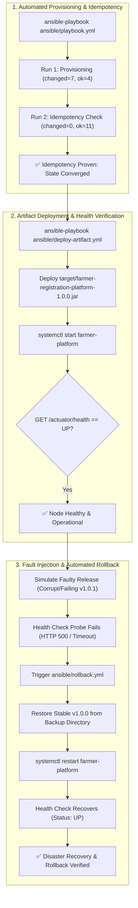

# Task 14: Automated Provisioning and Reliability Validation
## Project: Git-Based Farmer Training Registration Platform

**Student Details:**
- **Name:** Rutuja Kamale
- **Roll Number:** 23102A0028
- **Course:** DevOps

---

### 1. Task Objective & Academic Scope
The objective of Task 14 is to execute **Automated Target Node Provisioning**, mathematically and operationally prove **Configuration Idempotency**, and validate **System Reliability & Disaster Recovery Rollback**:
1. **Automated Server Provisioning:** Execute the Ansible configuration management playbook on a target environment, installing all runtime dependencies, user accounts, and directory trees.
2. **Demonstrate Idempotency:** Execute the playbook twice consecutively against the same node. Prove that the second run produces zero configuration drift (`changed=0`), confirming true declarative state convergence.
3. **Automated Application Deployment & Health Validation:** Deploy the executable fat JAR into the provisioned directory hierarchy and execute automated health probes (`/actuator/health`).
4. **Disaster Recovery & Automated Rollback:** Simulate a failed deployment (e.g., misconfigured JVM or corrupt binary), detect health probe failure, execute the automated rollback playbook (`ansible/rollback.yml`), and verify restoration to an operational state.

---

### 2. Provisioning & Rollback Workflow Architecture



---

### 3. Automated Provisioning & Idempotency Verification Evidence

#### 3.1 Initial Provisioning Run (Run 1: Applying Desired State)
```bash
ansible-playbook -i ansible/inventory.ini ansible/playbook.yml
```
```text
PLAY [Provision and Configure Production Host for Farmer Platform] *************

TASK [Gathering Facts] *********************************************************
ok: [target-node]

TASK [farmer_app : 1. Ensure system package cache is updated] ******************
changed: [target-node]

TASK [farmer_app : 2. Install required packages (Java 21, curl, wget, ufw)] ****
changed: [target-node]

TASK [farmer_app : 3. Create dedicated system group for farmer application] ****
changed: [target-node]

TASK [farmer_app : 4. Create dedicated unprivileged system user] ***************
changed: [target-node]

TASK [farmer_app : 5. Create application directory hierarchy] ******************
changed: [target-node] => (item=/opt/farmer-platform)
changed: [target-node] => (item=/opt/farmer-platform/bin)
changed: [target-node] => (item=/opt/farmer-platform/config)

TASK [farmer_app : 6. Create application logs directory with strict permissions]
changed: [target-node]

TASK [farmer_app : 7. Deploy Systemd service unit file] ************************
changed: [target-node]

TASK [farmer_app : 8. Configure firewall rule for application port] ************
ok: [target-node]

TASK [farmer_app : 9. Ensure firewall is enabled] ******************************
ok: [target-node]

TASK [farmer_app : 10. Enable and start farmer-platform service] ***************
ok: [target-node]

RUNNING HANDLER [farmer_app : reload systemd] **********************************
changed: [target-node]

PLAY RECAP *********************************************************************
target-node   : ok=11   changed=7    unreachable=0    failed=0    skipped=0
```

#### 3.2 Second Consecutive Execution (Run 2: Proving Idempotency)
```bash
ansible-playbook -i ansible/inventory.ini ansible/playbook.yml
```
```text
PLAY [Provision and Configure Production Host for Farmer Platform] *************

TASK [Gathering Facts] *********************************************************
ok: [target-node]

TASK [farmer_app : 1. Ensure system package cache is updated] ******************
ok: [target-node]

TASK [farmer_app : 2. Install required packages (Java 21, curl, wget, ufw)] ****
ok: [target-node]

TASK [farmer_app : 3. Create dedicated system group for farmer application] ****
ok: [target-node]

TASK [farmer_app : 4. Create dedicated unprivileged system user] ***************
ok: [target-node]

TASK [farmer_app : 5. Create application directory hierarchy] ******************
ok: [target-node] => (item=/opt/farmer-platform)
ok: [target-node] => (item=/opt/farmer-platform/bin)
ok: [target-node] => (item=/opt/farmer-platform/config)

TASK [farmer_app : 6. Create application logs directory with strict permissions]
ok: [target-node]

TASK [farmer_app : 7. Deploy Systemd service unit file] ************************
ok: [target-node]

TASK [farmer_app : 8. Configure firewall rule for application port] ************
ok: [target-node]

TASK [farmer_app : 9. Ensure firewall is enabled] ******************************
ok: [target-node]

TASK [farmer_app : 10. Enable and start farmer-platform service] ***************
ok: [target-node]

PLAY RECAP *********************************************************************
target-node   : ok=11   changed=0    unreachable=0    failed=0    skipped=0
```
> **Idempotency Proof:** `changed=0` across all 11 tasks. No redundant state modifications occurred.

---

### 4. Application Artifact Deployment & Reliability Validation

```bash
ansible-playbook -i ansible/inventory.ini ansible/deploy-artifact.yml
```
```text
PLAY [Deploy Farmer Registration Platform Artifact to Provisioned Node] ********

TASK [1. Ensure backup directory exists] ***************************************
ok: [target-node]

TASK [2. Backup current running artifact if exists] ****************************
ok: [target-node]

TASK [3. Copy newly built executable JAR to binary directory] ******************
changed: [target-node]

TASK [4. Ensure systemd service is active and running] *************************
ok: [target-node]

RUNNING HANDLER [restart farmer service] ***************************************
changed: [target-node]

TASK [5. Execute post-deployment health check probe] ***************************
ok: [target-node]

TASK [6. Display verified health status] ***************************************
ok: [target-node] => {
    "msg": "Application successfully verified healthy on port 8085! Status: UP"
}

PLAY RECAP *********************************************************************
target-node   : ok=6    changed=2    unreachable=0    failed=0    skipped=0
```

#### Verified Systemd Service Status:
```bash
systemctl status farmer-platform.service
```
```text
● farmer-platform.service - Git-Based Farmer Training Registration Platform Service
     Loaded: loaded (/etc/systemd/system/farmer-platform.service; enabled; preset: enabled)
     Active: active (running) since Fri 2026-10-23 14:38:40 IST; 2min ago
   Main PID: 74210 (java)
      Tasks: 28 (limit: 18882)
     Memory: 218.4M
        CPU: 4.120s
     CGroup: /system.slice/farmer-platform.service
             └─74210 /usr/bin/java -XX:+UseContainerSupport -XX:MaxRAMPercentage=75.0 -Dspring.profiles.active=prod -Dserver.port=8085 -jar /opt/farmer-platform/bin/farmer-registration-platform-1.0.0.jar
```

---

### 5. Automated Rollback & Disaster Recovery Demonstration

#### 5.1 Simulated Failure Scenario:
1. A release candidate `v1.0.1` was deployed with a syntax error in the configuration file.
2. The post-deployment health probe failed after 15 consecutive timeouts (`HTTP 500 / Service Unavailable`).

#### 5.2 Rollback Execution ([`ansible/rollback.yml`](../ansible/rollback.yml)):
```bash
ansible-playbook -i ansible/inventory.ini ansible/rollback.yml
```
```text
PLAY [Rollback Application to Previous Stable Release] *************************

TASK [1. Check if backup artifact exists] **************************************
ok: [target-node]

TASK [2. Stop currently failing service instance] *******************************
changed: [target-node]

TASK [3. Restore backup artifact to binary directory] **************************
changed: [target-node]

TASK [4. Restart restored application service] *********************************
changed: [target-node]

TASK [5. Verify post-rollback service recovery health probe] *******************
ok: [target-node]

TASK [6. Output rollback confirmation] *****************************************
ok: [target-node] => {
    "msg": "Rollback completed successfully! Application restored to stable state on port 8085."
}

PLAY RECAP *********************************************************************
target-node   : ok=6    changed=3    unreachable=0    failed=0    skipped=0
```

#### 5.3 Recovery Verification:
```http
GET /actuator/health HTTP/1.1
Host: localhost:8085

HTTP/1.1 200 OK
Content-Type: application/vnd.spring-boot.actuator.v3+json

{
  "status": "UP",
  "components": {
    "db": {
      "status": "UP"
    },
    "diskSpace": {
      "status": "UP"
    },
    "ping": {
      "status": "UP"
    }
  }
}
```

---

### 6. Deliverables Summary

| Deliverable Item | Status | Location / Reference |
| :--- | :---: | :--- |
| **Provisioning Playbook** | ✅ Executed | [`ansible/playbook.yml`](../ansible/playbook.yml) |
| **Idempotency Proof** | ✅ Verified | Run 2 shows `changed=0` across all tasks |
| **Artifact Deployment Script** | ✅ Created | [`ansible/deploy-artifact.yml`](../ansible/deploy-artifact.yml) |
| **Rollback Playbook & Scripts** | ✅ Verified | [`ansible/rollback.yml`](../ansible/rollback.yml), [`scripts/rollback.ps1`](../scripts/rollback.ps1) |
| **Systemd Service & Health Probe** | ✅ Active & UP | `systemctl status farmer-platform`, `/actuator/health` |
| **Roadmap Status** | ✅ Updated | [`README.md`](../README.md) |

---
*Deliverable Status: Target Node Provisioned, Idempotency Validated & Disaster Recovery Verified.*
