# Task 15: Final End-to-End Release, Documentation and Viva
## Project: Git-Based Farmer Training Registration Platform

**Student Details:**
- **Name:** Rutuja Kamale
- **Roll Number:** 23102A0028
- **Course:** DevOps
- **Release Version:** `v2.0.0-FINAL`

---

### 1. Executive Summary & Curriculum Completion
The **Git-Based Farmer Training Registration Platform** is an enterprise-grade agricultural capacity-building portal developed across an end-to-end **15-Task DevOps Curriculum Lifecycle**.

Every phase of the modern software delivery lifecycle has been implemented, validated, and documented:
- **Agile & Requirements Engineering:** User stories, Gherkin acceptance criteria, MoSCoW prioritization, and architectural design.
- **Git Collaboration & Branching:** Git flow branching model, pull request reviews, merge conflict simulation & resolution, and release tagging.
- **Continuous Integration (CI):** Automated Jenkins automation server, SCM polling, and JUnit test archiving.
- **Pipeline as Code & Server Deployment:** Declarative `Jenkinsfile` with environment profile parameterization (`dev`, `qa`, `prod`) and zero-downtime port management.
- **Continuous Testing:** Selenium WebDriver 4.25 E2E automated UI acceptance testing across 4 critical journeys with milestone screenshot captures and quality gate enforcement.
- **Containerization & Continuous Deployment (CD):** Multi-stage Docker build, non-root container hardening, Docker Compose orchestration, and automated commit-to-container continuous deployment.
- **Configuration Management & Reliability:** Modular Ansible roles, declarative Puppet manifests, mathematical proof of idempotency (`changed=0`), and automated disaster recovery rollback.

---

### 2. Complete 15-Task Curriculum Deliverables Index

| Task # | Task Title & Scope | Status | Deliverables & Artifacts |
| :---: | :--- | :---: | :--- |
| **Task 1** | **Problem Definition and Scope:** Real-time need analysis, stakeholder mapping, constraints, and 15-task MVP scope. | ✅ Completed | [Task 1 Deliverable Doc](task-1-problem-definition-and-scope.md) |
| **Task 2** | **Agile Planning and DevOps Workflow:** User stories, Gherkin criteria, MoSCoW backlog, Kanban roadmap, and Definition of Done. | ✅ Completed | [Task 2 Deliverable Doc](task-2-agile-devops-workflow.md) |
| **Task 3** | **Requirements, Architecture and Setup:** SRS, use-case diagram, architecture diagram, and Java 21/Spring Boot setup. | ✅ Completed | [Task 3 Deliverable Doc](task-3-requirements-architecture-setup.md), Source Code |
| **Task 4** | **Git & GitHub Repository Initialization:** GitHub setup, `.gitignore`, templates, branch policy, and semantic commits. | ✅ Completed | [Task 4 Deliverable Doc](task-4-git-github-initialization.md), [Branch Policy](branch-policy.md) |
| **Task 5** | **Feature Development with Branching:** Farmer registration workflow, classification engine, and PR merge. | ✅ Completed | [Task 5 Deliverable Doc](task-5-feature-development-with-branching.md), PR & Merge |
| **Task 6** | **MVP Completion & Git Collaboration:** District filtering, conflict resolution, and release tag `v1.0.0-MVP`. | ✅ Completed | [Task 6 Deliverable Doc](task-6-mvp-completion-git-collaboration.md), Tag `v1.0.0-MVP` |
| **Task 7** | **Jenkins Installation & CI Job:** Jenkins automation on port 8080, freestyle CI job, SCM polling, and artifact archiving. | ✅ Completed | [Task 7 Deliverable Doc](task-7-jenkins-ci-job.md), [Job Config XML](../ci/jenkins/job-config.xml) |
| **Task 8** | **Pipeline as Code & Server Deployment:** Declarative `Jenkinsfile`, environment profiles (`dev`, `qa`, `prod`), and deploy scripts. | ✅ Completed | [Task 8 Deliverable Doc](task-8-pipeline-as-code-server-deployment.md), [Jenkinsfile](../Jenkinsfile) |
| **Task 9** | **Selenium Test Design & Local Execution:** 4 critical E2E UI journeys, headless Chrome, assertions, and screenshot capture. | ✅ Completed | [Task 9 Deliverable Doc](task-9-selenium-test-design-local-execution.md), [Screenshots](screenshots/) |
| **Task 10** | **Continuous Testing in Jenkins:** Selenium quality gate, deliberate defect injection, red build failure, and fix commit recovery. | ✅ Completed | [Task 10 Deliverable Doc](task-10-continuous-testing-in-jenkins.md), [Quality Gate](../Jenkinsfile) |
| **Task 11** | **Docker Image & Container Lifecycle:** Multi-stage Dockerfile, unprivileged user, healthcheck, and 8 lifecycle states. | ✅ Completed | [Task 11 Deliverable Doc](task-11-docker-image-container-lifecycle.md), [Dockerfile](../Dockerfile) |
| **Task 12** | **Jenkins-Docker Continuous Deployment:** Automated versioned image build, registry push, fresh container teardown & deploy. | ✅ Completed | [Task 12 Deliverable Doc](task-12-jenkins-docker-continuous-deployment.md), [Jenkinsfile CD](../Jenkinsfile) |
| **Task 13** | **Configuration Management Script:** Target node prerequisites, modular Ansible role (`farmer_app`), and Puppet manifest. | ✅ Completed | [Task 13 Deliverable Doc](task-13-configuration-management-script.md), [Ansible](../ansible/), [Puppet](../puppet/) |
| **Task 14** | **Automated Provisioning & Reliability:** Provision clean host, proof of idempotency (`changed=0`), healthcheck, and rollback. | ✅ Completed | [Task 14 Deliverable Doc](task-14-automated-provisioning-reliability-validation.md), [Rollback](../ansible/rollback.yml) |
| **Task 15** | **Final Release, Documentation and Viva:** Complete DevOps execution, technical runbook, viva defense, and tag `v2.0.0-FINAL`. | ✅ Completed | [Task 15 Deliverable Doc](task-15-final-end-to-end-release-viva.md), Tag `v2.0.0-FINAL` |

---

### 3. End-to-End DevOps Lifecycle Architecture Diagram

```mermaid
flowchart LR
    subgraph 1. Code & Collaborate
        GIT[Git SCM & GitHub] --> BR[Feature Branching Flow]
        BR --> PR[Pull Request & Code Review]
    end

    subgraph 2. Continuous Integration
        PR --> J_SCM[Jenkins SCM Checkout]
        J_SCM --> J_BUILD[Maven Clean Compile]
        J_BUILD --> J_UNIT[JUnit 5 Unit & API Tests]
    end

    subgraph 3. Continuous Testing
        J_UNIT --> SEL[Selenium WebDriver E2E Tests]
        SEL --> QG{Quality Gate: 16 Tests Passed?}
        QG -->|No| RED[Halt Pipeline & Alert]
        QG -->|Yes| JAR[Package Fat JAR Artifact]
    end

    subgraph 4. Containerization & CD
        JAR --> D_BUILD[Docker Multi-Stage Build]
        D_BUILD --> D_REG[Push to Docker Registry]
        D_REG --> D_RUN[Deploy Fresh Container on Port 8085]
    end

    subgraph 5. Configuration & Reliability
        D_RUN --> ANS[Ansible / Puppet Provisioning]
        ANS --> IDEM[Idempotency Validated: changed=0]
        IDEM --> PROBE[Actuator Health Probe: UP]
        PROBE --> LIVE[🚀 Production Live: v2.0.0-FINAL]
    end
```

---

### 4. Comprehensive DevOps Viva & Oral Defense Preparation Guide

Below are the 10 core questions and comprehensive technical answers prepared for the final DevOps viva examination:

#### Q1: What branching strategy did you use, and how did it safeguard production stability?
> **Answer:** We implemented a customized **Git Flow** strategy documented in [`docs/branch-policy.md`](branch-policy.md). Direct pushes to `main` and `develop` are strictly prohibited. Developers work on isolated feature branches (`feature/<task-name>`). Pull requests require automated test verification before merging into `develop`. Release-ready builds are merged to `main` with immutable semantic tags (`v1.0.0-MVP`, `v2.0.0-FINAL`).

#### Q2: What is the architectural difference between your Task 7 Freestyle CI Job and Task 8 Pipeline as Code?
> **Answer:** In Task 7, the Freestyle job configured build steps via the Jenkins Web UI GUI, causing configuration drift and lack of version control. In Task 8, we implemented **Pipeline as Code** via a declarative [`Jenkinsfile`](../Jenkinsfile) stored at the repository root. This makes the entire delivery pipeline reproducible, auditable, and version-controlled alongside application code.

#### Q3: Why is Spring Boot with Embedded Tomcat preferred over standalone Tomcat in modern DevOps?
> **Answer:** Embedded Tomcat packages the web server directly inside the fat executable JAR (`java -jar app.jar`). This eliminates configuration drift across environments, removes the requirement to manually install and manage Tomcat on target servers, simplifies containerization into minimal Docker base images, and allows instant startup across diverse OS environments.

#### Q4: How does Selenium WebDriver execute in a headless CI/CD environment without a physical GUI display?
> **Answer:** We configured Chrome in headless mode using the `--headless=new` flag alongside `--no-sandbox`, `--disable-dev-shm-usage`, and `--disable-gpu`. This instructs the Chromium rendering engine to execute DOM rendering, JavaScript execution, and CSS layout entirely in memory with a virtual viewport (1920x1080), generating full-resolution screenshots without requiring an active X-server or Windows display.

#### Q5: What is the role of WebDriverManager in your automated test suite?
> **Answer:** Traditional Selenium required manually downloading and managing browser driver binaries (such as `chromedriver.exe`) matching the exact browser version. `io.github.bonigarcia:webdrivermanager` dynamically detects the installed Chrome version on the host, downloads the matching driver binary into a local cache, and configures the `webdriver.chrome.driver` system property automatically.

#### Q6: Explain the security benefits of your Multi-Stage Dockerfile.
> **Answer:** 
> 1. **Minimal Attack Surface:** The builder stage (`maven:3.9.6-alpine`) contains compilers and package managers, but the runtime stage uses `eclipse-temurin:21-jre-alpine`, reducing image size from ~800MB to ~280MB.
> 2. **Least Privilege (Non-Root User):** We created a dedicated system user `appuser` (UID 1000) and enforced `USER appuser`. If an attacker exploits a remote code execution vulnerability, they cannot gain root access to the host kernel.

#### Q7: How does container health monitoring work in your Docker configuration?
> **Answer:** We incorporated the `HEALTHCHECK` directive in the Dockerfile which executes `wget -q --spider http://localhost:8085/actuator/health` every 20 seconds. If the Spring Boot Actuator returns HTTP 200 with `{"status":"UP"}`, Docker marks the container as `healthy`. In container orchestrators (Docker Swarm or Kubernetes), unhealthy containers are automatically restarted or replaced.

#### Q8: What does Idempotency mean in Ansible, and how did you demonstrate it in Task 14?
> **Answer:** **Idempotency** means that executing an operation multiple times produces the exact same system state without unintended side effects. In Task 14, we ran our Ansible playbook once on a clean target (resulting in `ok=4, changed=7`), and then immediately re-ran the exact same playbook against the provisioned node. The second run produced `ok=11, changed=0`, proving that desired state was already met and zero unnecessary changes occurred.

#### Q9: How does the automated rollback playbook work in the event of a faulty release?
> **Answer:** Before deploying a new JAR in [`ansible/deploy-artifact.yml`](../ansible/deploy-artifact.yml), the active version is backed up into `/opt/farmer-platform/backups/`. If post-deployment Actuator health probes fail, the [`ansible/rollback.yml`](../ansible/rollback.yml) playbook stops the failing service, restores the backed-up artifact to the binary directory, restarts systemd, and re-validates health recovery back to `UP`.

#### Q10: Walk through the complete commit-to-production lifecycle in this platform.
> **Answer:** 
> 1. Developer pushes code to `feature/*`.
> 2. Jenkins triggers via SCM polling or webhook.
> 3. Pipeline executes checkout, compile, and JUnit unit tests.
> 4. Selenium UI tests execute against headless Chrome (Quality Gate).
> 5. Spring Boot fat JAR is packaged and archived.
> 6. Docker image is built with tag `<env>-b<build_number>` and pushed to registry.
> 7. Target server is provisioned via Ansible role `farmer_app` with systemd unit.
> 8. Container or systemd service is launched on port 8085.
> 9. Post-deployment smoke tests probe `/actuator/health` and `/api/trainings`.
> 10. Release tag is published and live application is confirmed operational.

---

### 5. Troubleshooting & Operations Runbook

| Symptom | Probable Root Cause | Resolution Command / Action |
| :--- | :--- | :--- |
| **Port 8085 Already in Use** | Stale Java process still listening | Run `powershell -File .\scripts\stop-app.ps1 -Port 8085` or `fuser -k 8085/tcp` |
| **Jenkins SCM Polling Timeout** | Git credentials or network latency | Verify repository URL in `Jenkinsfile` and test connection via `git ls-remote` |
| **Selenium Headless Timeout** | Browser binary not in standard path | Ensure Chrome is installed or configure `--headless=new` and explicit timeouts |
| **Docker Daemon Not Responding** | Docker Desktop engine stopped | Launch Docker Desktop or start Docker daemon service |
| **Ansible Permission Denied** | Non-privileged execution without `become` | Ensure `become: yes` is specified in playbook and SSH key is configured |
| **H2 Database Table Locked** | JVM stopped abruptly with open DB lock | Clean `target/` and restart app; in-memory H2 resets automatically |

---

### 6. Official Release Tagging (`v2.0.0-FINAL`)

The complete, fully verified codebase is tagged in Git:
- **Release Tag:** `v2.0.0-FINAL`
- **Release Name:** Git-Based Farmer Training Registration Platform - Complete DevOps Lifecycle
- **Git Commit:** Head of `main` branch
- **Test Pass Rate:** 100% (16/16 Automated Tests Passed)

---

### 7. Final Deliverables Summary

| Deliverable Item | Status | Location / Reference |
| :--- | :---: | :--- |
| **15-Task Complete Implementation** | ✅ 100% Done | All 15 curriculum tasks completed |
| **Complete Deliverables Documentation** | ✅ 15 Docs | [`docs/task-*.md`](../docs/) |
| **E2E Pipeline as Code** | ✅ Active | [`Jenkinsfile`](../Jenkinsfile) |
| **Automated Selenium Test Suite** | ✅ 16 Tests Passed | [`FarmerRegistrationUiTest.java`](../src/test/java/com/farmer/devops/selenium/FarmerRegistrationUiTest.java) |
| **Multi-Stage Docker & Compose** | ✅ Hardened | [`Dockerfile`](../Dockerfile), [`docker-compose.yml`](../docker-compose.yml) |
| **Ansible & Puppet Playbooks** | ✅ Idempotent | [`ansible/`](../ansible/), [`puppet/`](../puppet/) |
| **DevOps Viva Q&A Guide** | ✅ Complete | Section 4 of this report |
| **Final Release Tag** | ✅ Tagged | `v2.0.0-FINAL` |

---
*DevOps Lifecycle Curriculum Fully Completed, Verified & Approved for Academic Submission.*
