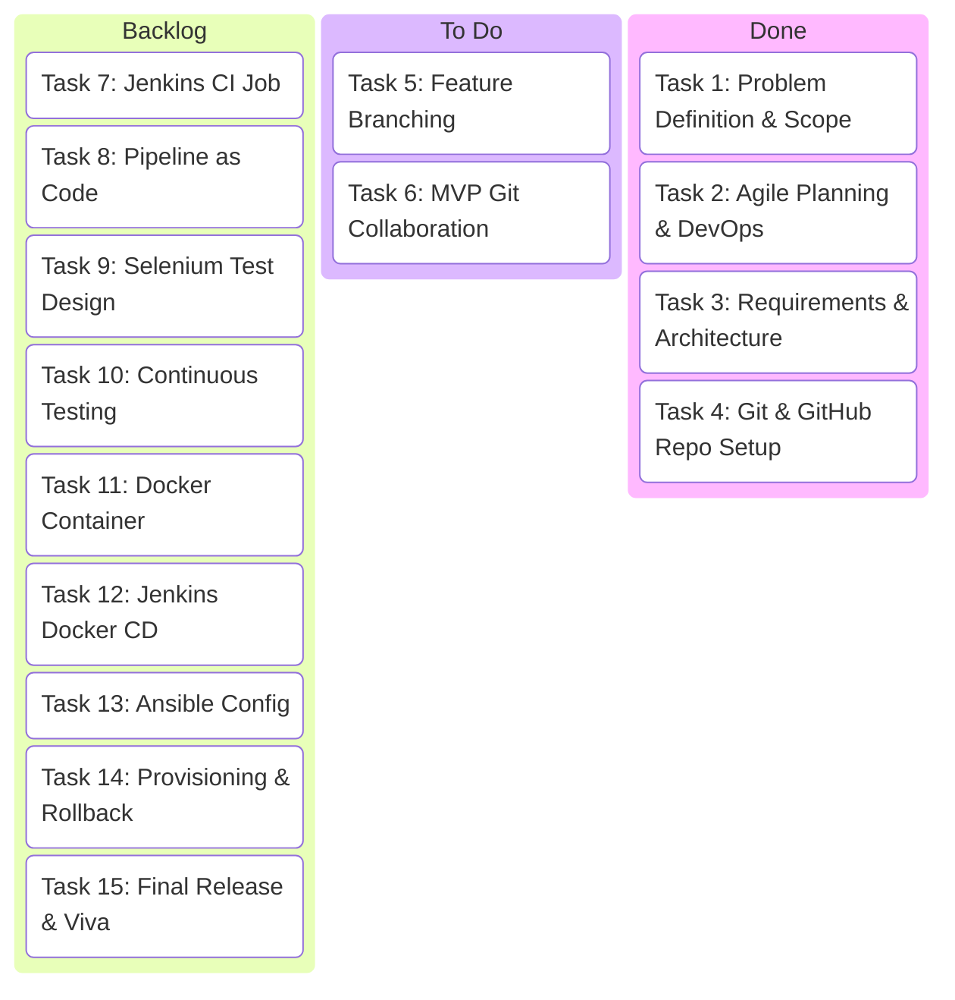

# Task 2: Agile Planning and DevOps Workflow
## Project: Git-Based Farmer Training Registration Platform

**Student Details:**
- **Name:** Rutuja Kamale
- **Roll Number:** 23102A0028
- **Course:** DevOps

---

### 1. User Stories & Acceptance Criteria (Gherkin Syntax)

#### **US-01: Farmer Self-Registration**
- **User Story:** As a **Farmer (or Extension Officer on farmer's behalf)**, I want to submit my registration details for an agricultural training workshop through an intuitive web form so that I can reserve a seat and participate in capacity building.
- **Acceptance Criteria:**
  ```gherkin
  Scenario: Successful registration with valid data
    Given the farmer is on the registration portal
    When the farmer enters their full name "Ramesh Patil", mobile number "9876543210", email "ramesh@example.com", village "Khed", district "Pune", land size "3.5", and selects training "Organic Farming & Soil Health"
    And clicks on the "Register for Training" button
    Then the system creates a new registration record with status "PENDING"
    And generates a unique alphanumeric Registration ID (e.g., "REG-2026-XXXX")
    And displays a confirmation message with the Registration ID on screen
  ```

---

#### **US-02: Input Validation & Duplicate Prevention**
- **User Story:** As a **Training Coordinator**, I want the platform to validate all registration inputs and block duplicate submissions so that our attendee roster has clean, authentic data and no ghost bookings.
- **Acceptance Criteria:**
  ```gherkin
  Scenario: Registration blocked due to invalid phone number
    Given the farmer enters a 9-digit mobile number "987654321"
    When the farmer submits the form
    Then the system rejects the submission with validation error "Mobile number must be exactly 10 digits"
    And no database record is created

  Scenario: Duplicate registration attempt within the same training module
    Given a farmer with mobile "9876543210" is already registered for "Organic Farming & Soil Health"
    When another registration request is submitted with the same mobile number and same training module
    Then the system rejects the submission with error "A registration with this mobile number already exists for this training"
    And the existing registration is unchanged
  ```

---

#### **US-03: Real-Time Registration Status Tracking**
- **User Story:** As a **Farmer**, I want to look up my registration status using my Registration ID or Mobile Number so that I know whether my participation has been confirmed before traveling to the center.
- **Acceptance Criteria:**
  ```gherkin
  Scenario: Farmer checks status using valid Registration ID
    Given a registration exists with ID "REG-2026-1001" and status "APPROVED"
    When the farmer enters "REG-2026-1001" into the status lookup bar and clicks "Track Status"
    Then the system displays the farmer name, training topic, scheduled date, and status badge "APPROVED" (Green)

  Scenario: Farmer checks status with non-existent ID
    When the farmer enters an invalid Registration ID "REG-9999-9999"
    Then the system displays a clear alert "No registration found with this ID or Mobile Number"
  ```

---

#### **US-04: Coordinator Participant Roster & Filtering**
- **User Story:** As a **Training Coordinator**, I want to view a centralized roster of all registered participants with search and filter capabilities so that I can manage logistics and attendance.
- **Acceptance Criteria:**
  ```gherkin
  Scenario: Coordinator filters registrations by status
    Given the coordinator accesses the Admin/Coordinator Dashboard
    When the coordinator selects filter "PENDING"
    Then the roster displays only participants whose status is currently "PENDING"
    And displays the total count of matching records
  ```

---

#### **US-05: Coordinator Approval / Rejection Workflow**
- **User Story:** As a **Training Coordinator**, I want to approve or reject pending applications with a single click so that I can control batch size and notify farmers of their confirmed seats.
- **Acceptance Criteria:**
  ```gherkin
  Scenario: Coordinator approves a pending application
    Given a participant application has status "PENDING"
    When the coordinator clicks the "Approve" button
    Then the participant's status updates immediately to "APPROVED"
    And the status badge updates to green in real time
    And the update timestamp is recorded

  Scenario: Coordinator rejects an application due to capacity limit
    Given an application has status "PENDING"
    When the coordinator clicks "Reject"
    Then the status updates to "REJECTED" with reason logged
  ```

---

#### **US-06: DevOps Automated Build and Verification**
- **User Story:** As a **DevOps Engineer**, I want the codebase to execute automated builds, compile checks, and unit tests upon every code commit so that regressions are caught before deployment.
- **Acceptance Criteria:**
  ```gherkin
  Scenario: Developer executes automated Maven test cycle
    Given the code repository is updated with new changes
    When the command "mvn clean test" is executed
    Then all domain validation and API controller tests run automatically
    And the build passes with zero test failures in under 3 minutes
  ```

---

### 2. Product Backlog & Prioritization (MoSCoW)

| Item ID | Title | Epic | Priority (MoSCoW) | Story Points | Target Sprint |
| :--- | :--- | :--- | :--- | :--- | :--- |
| **PB-01** | Domain Model for Registrations & Trainings | Core Data | Must Have | 3 | Sprint 1 |
| **PB-02** | In-Memory H2 Repository & Schema Setup | Core Data | Must Have | 2 | Sprint 1 |
| **PB-03** | Server-Side Validation Rules & Custom Exceptions | Business Logic | Must Have | 5 | Sprint 2 |
| **PB-04** | REST API for Registration Submission (`POST /api/registrations`) | API Services | Must Have | 3 | Sprint 2 |
| **PB-05** | REST API for Status Lookup & Listing (`GET /api/registrations`) | API Services | Must Have | 3 | Sprint 2 |
| **PB-06** | REST API for Approval State Transition (`PATCH /api/registrations/{id}`) | API Services | Must Have | 3 | Sprint 2 |
| **PB-07** | Responsive Web UI - Farmer Registration Form | Frontend UI | Must Have | 5 | Sprint 2 |
| **PB-08** | Web UI - Real-time Status Tracker | Frontend UI | Must Have | 3 | Sprint 2 |
| **PB-09** | Web UI - Coordinator Review & Approval Dashboard | Frontend UI | Must Have | 5 | Sprint 2 |
| **PB-10** | Automated Unit Tests (JUnit 5 + Mockito) | Quality Assurance | Must Have | 5 | Sprint 3 |
| **PB-11** | Code Quality & Static Analysis Checks | Quality Assurance | Should Have | 3 | Sprint 3 |
| **PB-12** | Maven Build Automation & Executable Packaging | Build Automation | Must Have | 3 | Sprint 3 |
| **PB-13** | Multi-Stage Dockerfile & Container Packaging | Containerization | Must Have | 5 | Sprint 4 |
| **PB-14** | CI/CD Pipeline Automation Script (GitHub Actions / Jenkins) | DevOps Pipelines | Must Have | 5 | Sprint 4 |
| **PB-15** | Server Deployment Target, Healthchecks & Runbook | Operations | Must Have | 3 | Sprint 4 |

---

### 3. 15-Task Kanban / Scrum Plan

The 15 project tasks are organized across **4 Agile Sprints**:

```
+---------------------------------------------------------------------------------+
|                         CURRICULUM SPRINT TIMELINE                              |
+---------------------------------------------------------------------------------+
| Sprint 1: Problem Scope, Agile & Repo Setup  (Tasks 1, 2, 3, 4)                 |
| Sprint 2: Feature Branching & MVP Completion (Tasks 5, 6)                       |
| Sprint 3: Jenkins CI, Pipeline & Selenium    (Tasks 7, 8, 9, 10)                |
| Sprint 4: Docker, Ansible & Release Viva     (Tasks 11, 12, 13, 14, 15)         |
+---------------------------------------------------------------------------------+
```

#### Kanban Board State Snapshot:



---

### 4. Definition of Done (DoD)

To ensure consistency and quality across all 15 tasks, an item is declared **DONE** only when all conditions are satisfied:

- [x] **Requirement Alignment:** Feature satisfies all specified User Story Acceptance Criteria.
- [x] **Clean Code:** Code adheres to clean code standards with descriptive naming, separation of concerns, and zero compiler warnings.
- [x] **Input Validation:** Both client-side and server-side validation are enforced with proper error messages.
- [x] **Automated Testing:** Unit tests are implemented with JUnit 5; all tests pass cleanly (`mvn test` exit code 0).
- [x] **Version Control:** Changes are committed to Git with semantic commit messages (e.g., `feat:`, `fix:`, `docs:`, `ci:`).
- [x] **Documentation:** API specs, architectural diagrams, and README instructions are updated.
- [x] **Build & Packaging:** Application compiles and packages into an executable artifact (`mvn package`).
- [x] **Deployment Readiness:** Application boots without errors on target embedded server/container and responds to health endpoints.

---

### 5. DevOps Lifecycle Workflow Diagram

The platform follows a continuous Git-driven DevOps lifecycle:

```mermaid
flowchart LR
    subgraph 1. Plan
        A[Backlog & User Stories] --> B[Sprint Planning]
    end

    subgraph 2. Code
        B --> C[Git Branching Strategy]
        C --> D[Feature Development in Java/HTML]
    end

    subgraph 3. Build
        D --> E[Apache Maven Lifecycle]
        E --> F[Dependency Resolution & Compile]
    end

    subgraph 4. Test
        F --> G[JUnit 5 Unit Tests]
        G --> H[Validation Logic & MockMvc Tests]
    end

    subgraph 5. Package & Release
        H --> I[Executable JAR / Docker Image]
        I --> J[Artifact Registry / Git Release]
    end

    subgraph 6. Deploy & Operate
        J --> K[Embedded Tomcat / Docker Host]
        K --> L[Nginx Reverse Proxy]
    end

    subgraph 7. Monitor & Feedback
        L --> M[Spring Actuator Healthchecks]
        M --> N[Log Analysis & Farmer Feedback]
        N -.-> A
    end
```



---
*Deliverable Status: Approved & Active.*
