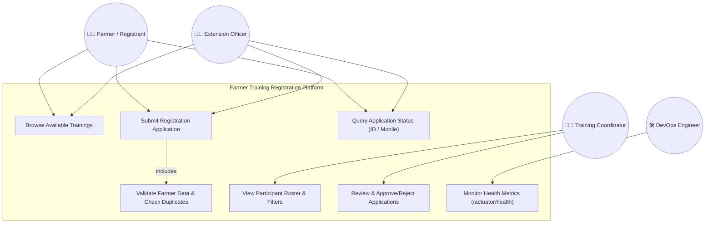
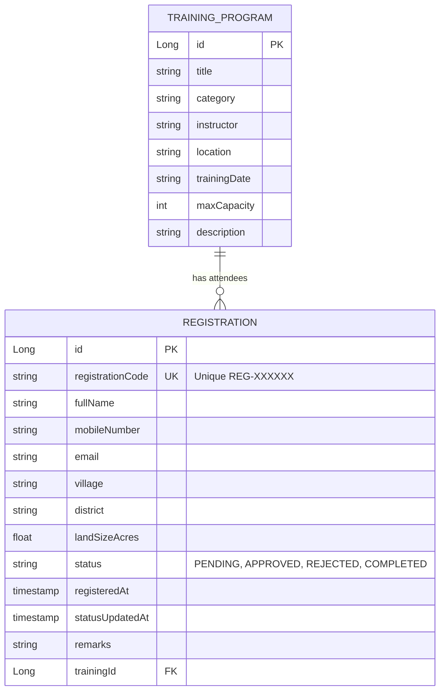

# Task 3: Requirements, Architecture and Technology Setup
## Project: Git-Based Farmer Training Registration Platform

**Student Details:**
- **Name:** Rutuja Kamale
- **Roll Number:** 23102A0028
- **Course:** DevOps

---

### 1. Software Requirements Specification (SRS) Summary

#### 1.1 Functional Requirements (FR)
- **FR-01 (Training Catalog Browsing):** The system shall provide a catalog of available agricultural training programs (e.g., Organic Farming, Drip Irrigation, Crop Pest Control, Precision Ag Tech) with schedule date, location, instructor, and seat capacity.
- **FR-02 (Farmer Registration Form):** The system shall allow farmers or extension officers to submit a registration application by capturing:
  - Full Name
  - Mobile Number (10 digits)
  - Email Address (optional)
  - Village & District
  - Land Size (in acres)
  - Selected Training Program ID
- **FR-03 (Server-Side Validation):** The system shall validate all submitted inputs:
  - Required fields cannot be empty or blank.
  - Mobile number must be a valid 10-digit number.
  - Land size must be a positive number.
  - Reject duplicate registrations (same mobile number registered for the same training module).
- **FR-04 (Unique Registration ID Generation):** Upon successful registration, the system shall assign a unique registration identifier in the format `REG-XXXXXX` and default status `PENDING`.
- **FR-05 (Registration Status Tracking):** The platform shall allow any user to query their registration status by entering either their unique Registration ID or Mobile Number.
- **FR-06 (Coordinator Participant Listing):** The system shall provide an administrative participant roster displaying registered farmers, their details, training program, registration timestamp, and current status.
- **FR-07 (Approval / Confirmation Workflow):** Training coordinators shall have authority to:
  - **Approve** an application (transitions status from `PENDING` -> `APPROVED`).
  - **Reject** an application (transitions status from `PENDING` -> `REJECTED`).
  - **Mark Attended** (transitions status from `APPROVED` -> `COMPLETED`).
- **FR-08 (DevOps Health & Metrics):** The system shall expose a `/actuator/health` endpoint returning system operational status (`UP`) for monitoring and container orchestration.

#### 1.2 Non-Functional Requirements (NFR)
- **NFR-01 (Performance & Latency):** Web pages must load within 1.5 seconds. REST API response time for search and submissions must be under 300 ms.
- **NFR-02 (Availability & Reliability):** 99.9% uptime target. System must handle unexpected inputs gracefully without crashing (standard HTTP 400 Bad Request responses with error payloads).
- **NFR-03 (Usability & Responsiveness):** Clean, accessible, mobile-responsive user interface optimized for rural smartphone screens and desktop kiosk browsers.
- **NFR-04 (Maintainability & Testability):** 100% of core business validation rules covered by automated unit tests. Clean layered architecture (Controller -> Service -> Repository -> Entity).
- **NFR-05 (Build & Deployment Portability):** Build tool must run standalone via Apache Maven without requiring pre-installed external database servers. Embedded H2 database with automatic schema migrations.
- **NFR-06 (Security & Auditing):** Input sanitization to prevent SQL injection and Cross-Site Scripting (XSS). Audit timestamps (`createdAt`, `updatedAt`) stored for every registration state change.

---

### 2. Use-Case Diagram



---

### 3. System Architecture Diagram

The platform uses a layered enterprise architecture designed for DevOps automation and container deployment:

```mermaid
flowchart TD
    subgraph ClientLayer ["Client Layer (Presentation)"]
        Browser["Responsive Web App (HTML5 / Modern CSS / Vanilla JS)"]
        Curl["API Clients / Automated Test Scripts"]
    end

    subgraph ApplicationServer ["Application Server (Spring Boot / Java 21)"]
        direction TB
        subgraph WebTier ["Web & Controller Tier"]
            RegCtrl["RegistrationController (REST API)"]
            PageCtrl["WebViewController (Portal Views)"]
            ActuatorCtrl["Actuator Health / Metrics API"]
        end

        subgraph ServiceTier ["Business Logic & Validation Tier"]
            RegService["RegistrationService"]
            ValService["ValidationEngine (Duplicate & Format Checks)"]
        end

        subgraph DataTier ["Persistence Tier (Spring Data JPA)"]
            RegRepo["RegistrationRepository"]
            TrainRepo["TrainingRepository"]
        end
    end

    subgraph StorageLayer ["Storage Layer"]
        H2DB[("Embedded H2 In-Memory / File Database")]
    end

    subgraph DevOpsTarget ["DevOps & Deployment Targets"]
        Maven["Apache Maven Build & Test Engine"]
        DockerHost["Docker Container (Eclipse Temurin 21 JRE)"]
        TomcatNginx["Embedded Tomcat / Nginx Reverse Proxy"]
    end

    Browser -->|HTTP GET/POST /| PageCtrl
    Browser -->|REST API Calls (JSON)| RegCtrl
    Curl -->|REST API Calls| RegCtrl
    Curl -->|Healthcheck Probe| ActuatorCtrl

    RegCtrl --> RegService
    RegService --> ValService
    RegService --> RegRepo
    RegService --> TrainRepo

    RegRepo --> H2DB
    TrainRepo --> H2DB

    Maven -.->|Compiles & Packages| ApplicationServer
    ApplicationServer -.->|Containerized into| DockerHost
    DockerHost -.->|Deployed with| TomcatNginx
```

---

### 4. Data Model (Entity-Relationship & Schema)



#### Database Table Definitions:

1. **`training_programs` Table:**
   - `id`: `BIGINT AUTO_INCREMENT PRIMARY KEY`
   - `title`: `VARCHAR(150) NOT NULL`
   - `category`: `VARCHAR(80) NOT NULL` (e.g., "Organic Farming", "Irrigation", "Pest Management")
   - `instructor`: `VARCHAR(100) NOT NULL`
   - `location`: `VARCHAR(120) NOT NULL`
   - `training_date`: `VARCHAR(50) NOT NULL`
   - `max_capacity`: `INTEGER NOT NULL DEFAULT 40`
   - `description`: `VARCHAR(500)`

2. **`registrations` Table:**
   - `id`: `BIGINT AUTO_INCREMENT PRIMARY KEY`
   - `registration_code`: `VARCHAR(32) NOT NULL UNIQUE` (e.g. `REG-789042`)
   - `full_name`: `VARCHAR(100) NOT NULL`
   - `mobile_number`: `VARCHAR(15) NOT NULL`
   - `email`: `VARCHAR(100)`
   - `village`: `VARCHAR(80) NOT NULL`
   - `district`: `VARCHAR(80) NOT NULL`
   - `land_size_acres`: `DOUBLE NOT NULL`
   - `status`: `VARCHAR(20) NOT NULL DEFAULT 'PENDING'` (`PENDING`, `APPROVED`, `REJECTED`, `COMPLETED`)
   - `registered_at`: `TIMESTAMP NOT NULL DEFAULT CURRENT_TIMESTAMP`
   - `status_updated_at`: `TIMESTAMP`
   - `remarks`: `VARCHAR(255)`
   - `training_id`: `BIGINT NOT NULL REFERENCES training_programs(id)`

---

### 5. REST API Specifications

| Method | Endpoint | Request Body | Response Code | Description |
| :--- | :--- | :--- | :--- | :--- |
| `GET` | `/api/trainings` | None | `200 OK` | Retrieves list of all available training workshops. |
| `GET` | `/api/trainings/{id}` | None | `200 OK` / `404 Not Found` | Retrieves details of a specific training program. |
| `POST` | `/api/registrations` | JSON (Registration details) | `201 Created` / `400 Bad Request` | Submits farmer registration with validation checks. |
| `GET` | `/api/registrations` | Query params: `?status=...&trainingId=...` | `200 OK` | Retrieves list of all registrations (filtered by status or training). |
| `GET` | `/api/registrations/track` | Query param: `?query=REG-XXXXXX or phone` | `200 OK` / `404 Not Found` | Self-service status lookup by Registration ID or Phone Number. |
| `PATCH` | `/api/registrations/{id}/status` | JSON: `{"status": "APPROVED", "remarks": "Eligible"}` | `200 OK` / `400 Bad Request` | Coordinator updates status (Approve / Reject / Complete). |
| `GET` | `/actuator/health` | None | `200 OK` (`{"status":"UP"}`) | DevOps healthcheck probe. |

---

### 6. Technology Stack Selection & Rationale

| Layer | Selected Technology | Version | Engineering Rationale |
| :--- | :--- | :--- | :--- |
| **Runtime & Language** | Java SE Development Kit (JDK) | **21 LTS** | High performance, virtual threads, modern pattern matching, LTS support. |
| **Framework** | Spring Boot | **3.3.4** | Industry-standard rapid application framework with production-ready Actuator metrics. |
| **Build & Dependency Tool** | Apache Maven | **3.9.x** | Declarative build lifecycle (`compile`, `test`, `package`), universally supported in CI/CD pipelines. |
| **Embedded Web Server** | Apache Tomcat | **10.1.x** (Embedded) | Built into Spring Boot; eliminates manual WAR deployments; fast startup. |
| **Data Persistence** | Spring Data JPA / Hibernate | **6.5.x** | Object-Relational Mapping (ORM) with clean repository abstractions. |
| **Database** | H2 Database Engine | **2.3.x** | Zero-dependency local setup, in-memory and persistent file modes, built-in SQL console. |
| **Frontend Interface** | Modern Responsive HTML5 / CSS3 / Vanilla JS | ES6+ | Lightweight, zero-build-pipeline overhead for client assets, fast loading on mobile rural networks. |
| **Testing Framework** | JUnit 5 + Mockito + MockMvc | 5.10.x | Comprehensive unit testing and integration testing of services and REST controllers. |
| **Deployment Target** | Docker Container / Nginx | Alpine / Debian Slim | Standard containerization target for DevOps pipelines. |

---

### 7. Local Development Setup & Verification Guide

#### Prerequisites Installed on Machine:
- Java JDK 21 (`java -version`)
- Apache Maven 3.9+ (`mvn -version`)
- Git (`git --version`)

#### Build & Run Commands:
```bash
# 1. Clean and run all automated unit tests
mvn clean test

# 2. Package executable application JAR
mvn clean package -DskipTests=false

# 3. Launch application locally on port 8080
java -jar target/farmer-registration-platform-1.0.0.jar
# or via Maven
mvn spring-boot:run
```

#### Access URLs:
- **Web Application Portal:** `http://localhost:8080/`
- **Farmer Status Tracker:** `http://localhost:8080/tracker`
- **Coordinator Dashboard:** `http://localhost:8080/admin`
- **DevOps Health Check:** `http://localhost:8080/actuator/health`
- **H2 Database Console:** `http://localhost:8080/h2-console`

---
*Deliverable Status: Approved & Local Implementation In Progress.*
