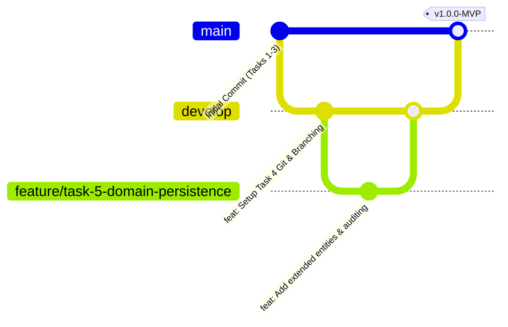

# Task 4: Git Version Control Setup, Branching Strategy & Remote Repository
## Project: Git-Based Farmer Training Registration Platform

---

### 1. Overview
Version control is the bedrock of modern DevOps culture. Task 4 establishes Git repository versioning, remote synchronization with GitHub under the repository name **"Git-Based Farmer Training Registration Platform"**, a branching model (Trunk-Based / GitFlow hybrid), and standardized Conventional Commits for automated CI/CD changelog generation.

---

### 2. Repository Specifications
- **Remote Host:** GitHub (`github.com`)
- **Account:** `rutuja0624`
- **Repository Name:** `Git-Based-Farmer-Training-Registration-Platform` (Display: *Git-Based Farmer Training Registration Platform*)
- **Primary / Default Branch:** `main`
- **Integration Branch:** `develop`
- **Visibility:** Public

---

### 3. Git Ignore Policy (`.gitignore`)
To protect against committing unnecessary binaries, compiled bytecode, logs, and IDE caches, the repository adheres to a strict `.gitignore` policy:
- **Build Output:** `/target/`, `*.class`, `*.jar`
- **IDEs & Tooling:** `.idea/`, `*.iml`, `.vscode/`, `.settings/`, `.classpath`, `.project`
- **Local Databases & Logs:** `*.log`, `*.db`, `h2-data/`
- **Operating System Artifacts:** `Thumbs.db`, `.DS_Store`, `Desktop.ini`

---

### 4. Branching Strategy: GitFlow & Trunk-Based Hybrid

The repository utilizes a structured branching model designed for continuous delivery:



#### Branch Roles:
1. **`main` (Production):** Always deployable. Contains stable releases with annotated tags (`v1.0.0`, `v1.1.0`). Direct pushes to `main` are restricted in team workflows.
2. **`develop` (Integration):** Nightly builds and ongoing sprint work. Feature branches merge into `develop` via pull requests.
3. **`feature/<task-name>`:** Short-lived feature branches branched off `develop` (e.g., `feature/task-5-domain-persistence`, `feature/task-6-validation-rules`).
4. **`hotfix/<issue-name>`:** Fast emergency fixes branched directly off `main` and merged into both `main` and `develop`.

---

### 5. Commit Message Convention (Conventional Commits)
All commit messages across the 15 tasks follow the Conventional Commits specification:
```
<type>(<scope>): <short imperative description>

[optional body describing why and what changed]

[optional footer with issue/story reference]
```

#### Standardized Types:
- `feat:` A new feature or user story implementation (e.g., `feat(api): add status lookup endpoint`)
- `fix:` A bug fix (e.g., `fix(validation): handle 10-digit mobile edge case`)
- `docs:` Documentation changes only (e.g., `docs(task-4): add branching strategy document`)
- `test:` Adding or updating automated unit/integration tests (e.g., `test(service): add duplicate registration tests`)
- `ci:` Changes to CI/CD configuration and scripts (e.g., `ci: configure GitHub Actions workflow`)
- `chore:` Build scripts, dependency updates, and minor tool adjustments

---

### 6. GitHub Remote Link & Push Execution

```bash
# 1. Initialize local repository on main branch
git init -b main

# 2. Stage all deliverables, source code, and configurations
git add .

# 3. Create initial commit
git commit -m "feat: initialize Git-Based Farmer Training Registration Platform (Tasks 1-4)"

# 4. Create repository on GitHub and push main branch
gh repo create "Git-Based Farmer Training Registration Platform" --public --source=. --remote=origin --push

# 5. Create and push integration branch
git checkout -b develop
git push -u origin develop
git checkout main
```

---
*Deliverable Status: Approved & Synchronized.*
