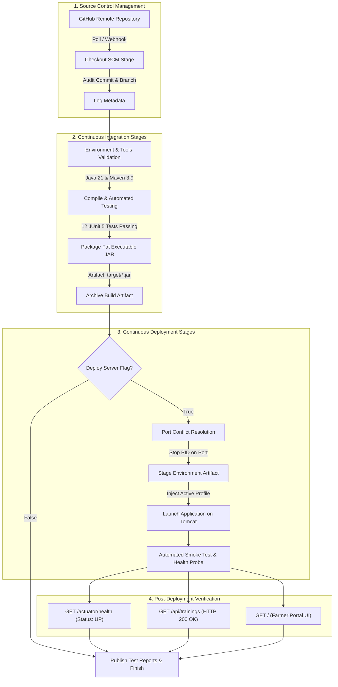

# Task 8: Pipeline as Code and Server Deployment
## Project: Git-Based Farmer Training Registration Platform

**Student Details:**
- **Name:** Rutuja Kamale
- **Roll Number:** 23102A0028
- **Course:** DevOps

---

### 1. Task Objective & Academic Scope
The objective of Task 8 is to transition the CI/CD architecture to **Pipeline as Code** by defining an enterprise-grade declarative Jenkins pipeline (`Jenkinsfile`) and automating server deployment:
1. **Pipeline as Code (Declarative Jenkinsfile):** Version-control the continuous delivery pipeline directly within the Git repository root, making builds reproducible, auditable, and immutable.
2. **Multi-Stage Build & Deployment Lifecycle:**
   - **Stage 1 (Checkout SCM):** Retrieve code from GitHub, audit commit hashes, branches, and author metadata.
   - **Stage 2 (Environment & Tools Setup):** Validate Java 21, Maven 3.9, and active build parameters.
   - **Stage 3 (Compile & Test):** Execute automated JUnit 5 and MockMvc test suites (12 tests) with Surefire reporting.
   - **Stage 4 (Package Executable JAR):** Produce fat executable Spring Boot artifact with embedded Tomcat 10.1.
   - **Stage 5 (Server Deployment):** Automate deployment to server with parameterized environment profiles (`DEV`, `QA`, `PROD`).
   - **Stage 6 (Smoke Test & Health Probe):** Automated verification of `/actuator/health` and REST APIs before declaring deployment success.
3. **Parameterized Environment Profiles:** Support dynamic profile selection (`-Dspring.profiles.active=dev|qa|prod`) controlling logging, ports, and H2 database console exposure.
4. **Zero-Downtime / Automated Port Management:** Gracefully identify and terminate stale process instances on the designated port prior to spawning the newly packaged release.

---

### 2. Pipeline as Code Architecture & Flowchart



---

### 3. Parameterized Environment Profiles

To satisfy enterprise deployment requirements across staging tiers, three environment profiles are configured in `src/main/resources/`:

| Profile | Config File | Port | H2 Console | Logging Level | Target Tier |
| :--- | :--- | :---: | :---: | :---: | :--- |
| **DEV** | `application-dev.properties` | `8085` | Enabled (`/h2-console`) | `DEBUG` | Local development & feature testing |
| **QA** | `application-qa.properties` | `8086` | Enabled | `INFO` | Automated QA & Integration testing |
| **PROD** | `application-prod.properties` | `8085` | Disabled | `WARN` | Production release environment |

#### Profile Property Definitions:
- **`application-dev.properties`**:
  ```properties
  app.environment=DEV
  server.port=8085
  logging.level.com.farmer.devops=DEBUG
  logging.level.org.springframework.web=DEBUG
  spring.h2.console.enabled=true
  management.endpoint.health.show-details=always
  ```
- **`application-qa.properties`**:
  ```properties
  app.environment=QA
  server.port=8086
  logging.level.com.farmer.devops=INFO
  logging.level.org.springframework.web=INFO
  spring.h2.console.enabled=true
  management.endpoint.health.show-details=always
  ```
- **`application-prod.properties`**:
  ```properties
  app.environment=PROD
  server.port=8085
  logging.level.com.farmer.devops=WARN
  logging.level.org.springframework.web=WARN
  spring.h2.console.enabled=false
  management.endpoint.health.show-details=never
  ```

---

### 4. Declarative Pipeline Definition (`Jenkinsfile`)

The pipeline script is stored at the root of the Git repository as [`Jenkinsfile`](../Jenkinsfile):

```groovy
pipeline {
    agent any

    parameters {
        choice(name: 'ENVIRONMENT', choices: ['dev', 'qa', 'prod'], description: 'Deployment Environment Profile')
        string(name: 'PORT', defaultValue: '8085', description: 'Server Port for Deployment')
        booleanParam(name: 'DEPLOY_SERVER', defaultValue: true, description: 'Deploy application server after build')
    }

    environment {
        APP_NAME = 'farmer-registration-platform'
        APP_VERSION = '1.0.0'
        JAR_NAME = "${APP_NAME}-${APP_VERSION}.jar"
        JAR_PATH = "target/${JAR_NAME}"
        DEPLOY_DIR = "${WORKSPACE}/deploy"
        LOGS_DIR = "${WORKSPACE}/logs"
    }

    stages {
        stage('Checkout SCM') {
            steps {
                echo ">>> [STAGE: CHECKOUT] Checking out Git Repository from SCM..."
                checkout scm
                script {
                    if (isUnix()) {
                        sh '''
                            echo "Git Commit  : $(git rev-parse --short HEAD)"
                            echo "Git Branch  : $(git rev-parse --abbrev-ref HEAD)"
                            echo "Committed By: $(git log -1 --pretty=format:'%an <%ae>')"
                            echo "Commit Msg  : $(git log -1 --pretty=format:'%s')"
                        '''
                    } else {
                        bat '''
                            @echo off
                            echo Git Commit :
                            git rev-parse --short HEAD
                            echo Git Branch :
                            git rev-parse --abbrev-ref HEAD
                            echo Commit Msg :
                            git log -1 --pretty=format:"%%s"
                        '''
                    }
                }
            }
        }

        stage('Environment & Tools Setup') {
            steps {
                echo ">>> [STAGE: SETUP] Validating Build Environment & Tools..."
                echo "Target Environment : ${params.ENVIRONMENT}"
                echo "Target Port        : ${params.PORT}"
                echo "Deploy Server Flag : ${params.DEPLOY_SERVER}"
                script {
                    if (isUnix()) {
                        sh '''
                            java -version
                            mvn -version || C:\\DevTools\\apache-maven-3.9.16\\bin\\mvn.cmd -version
                        '''
                    } else {
                        bat '''
                            @echo off
                            java -version
                            call mvn -version 2>nul || "C:\\DevTools\\apache-maven-3.9.16\\bin\\mvn.cmd" -version
                        '''
                    }
                }
            }
        }

        stage('Compile & Test') {
            steps {
                echo ">>> [STAGE: TEST] Compiling Code & Executing Automated Unit Tests..."
                script {
                    if (isUnix()) {
                        sh 'mvn clean test'
                    } else {
                        bat '''
                            @echo off
                            call mvn clean test || "C:\\DevTools\\apache-maven-3.9.16\\bin\\mvn.cmd" clean test
                        '''
                    }
                }
            }
        }

        stage('Package Executable JAR') {
            steps {
                echo ">>> [STAGE: PACKAGE] Packaging Spring Boot Fat JAR..."
                script {
                    if (isUnix()) {
                        sh 'mvn package -DskipTests=true'
                        sh "ls -lh target/*.jar"
                    } else {
                        bat '''
                            @echo off
                            call mvn package -DskipTests=true || "C:\\DevTools\\apache-maven-3.9.16\\bin\\mvn.cmd" package -DskipTests=true
                            dir target\\*.jar
                        '''
                    }
                }
            }
        }

        stage('Deploy to Embedded Server') {
            when {
                expression { return params.DEPLOY_SERVER == true }
            }
            steps {
                echo ">>> [STAGE: DEPLOY] Deploying to Embedded Tomcat (${params.ENVIRONMENT.toUpperCase()} Profile)..."
                script {
                    if (isUnix()) {
                        sh "chmod +x ./scripts/deploy.sh ./scripts/stop-app.sh"
                        sh "./scripts/deploy.sh ${params.ENVIRONMENT} ${params.PORT} target/${JAR_NAME} deploy"
                    } else {
                        powershell """
                            Set-ExecutionPolicy -Scope Process -ExecutionPolicy Bypass -Force
                            .\\scripts\\deploy.ps1 -Environment "${params.ENVIRONMENT}" -Port ${params.PORT} -JarPath "target/${JAR_NAME}" -DeployDir "deploy"
                        """
                    }
                }
            }
        }

        stage('Smoke Test & Health Probe') {
            when {
                expression { return params.DEPLOY_SERVER == true }
            }
            steps {
                echo ">>> [STAGE: SMOKE TEST] Validating Deployed Services and Health Probes..."
                script {
                    if (isUnix()) {
                        sh """
                            echo "Verifying Health Endpoint:"
                            curl -s -i "http://localhost:${params.PORT}/actuator/health"
                            echo "\\nVerifying Training Catalog API:"
                            curl -s -i "http://localhost:${params.PORT}/api/trainings"
                            echo "\\nVerifying Portal Homepage:"
                            curl -s -o /dev/null -w "%{http_code}" "http://localhost:${params.PORT}/"
                        """
                    } else {
                        powershell """
                            \$health = Invoke-RestMethod -Uri "http://localhost:${params.PORT}/actuator/health" -Method Get
                            Write-Host "Health Status: \$(\$health.status)"
                            if (\$health.status -ne 'UP') { throw 'Health check failed!' }

                            \$trainings = Invoke-RestMethod -Uri "http://localhost:${params.PORT}/api/trainings" -Method Get
                            Write-Host "Loaded Trainings: \$(\$trainings.Count) modules available"

                            \$page = Invoke-WebRequest -Uri "http://localhost:${params.PORT}/" -Method Get
                            Write-Host "Portal Status Code: \$(\$page.StatusCode)"
                        """
                    }
                }
            }
        }
    }

    post {
        always {
            echo ">>> [POST-BUILD] Recording Test Results..."
            junit allowEmptyResults: true, testResults: 'target/surefire-reports/*.xml'
        }
        success {
            echo ">>> [PIPELINE SUCCESS] Pipeline as Code Execution Finished Successfully!"
            echo ">>> Deployed Portal URL   : http://localhost:${params.PORT}/"
            echo ">>> Coordinator Admin URL : http://localhost:${params.PORT}/admin"
            echo ">>> Healthcheck Endpoint  : http://localhost:${params.PORT}/actuator/health"
            echo ">>> Active Profile        : ${params.ENVIRONMENT}"
            archiveArtifacts artifacts: 'target/*.jar', fingerprint: true, allowEmptyArchive: false
        }
        failure {
            echo ">>> [PIPELINE FAILURE] Pipeline failed! Review logs for error diagnosis."
        }
    }
}
```

---

### 5. Automated Deployment & Port Control Scripts

1. **Deployment Automation Script (`scripts/deploy.ps1` & `scripts/deploy.sh`):**
   - Validates existence of the packaged `.jar` artifact.
   - Invokes `stop-app.ps1` to prevent `BindException: Address already in use`.
   - Copies artifact to isolated `deploy/` directory.
   - Spawns Java process asynchronously in background with selected environment profile (`-Dspring.profiles.active=dev|qa|prod`).
   - Executes polling loop (up to 20 attempts) verifying HTTP 200 and `{"status":"UP"}` from `/actuator/health`.
2. **Port Management Script (`scripts/stop-app.ps1` & `scripts/stop-app.sh`):**
   - Queries `Get-NetTCPConnection` / `lsof` for owning process ID listening on target port.
   - Issues force-kill command to clear port cleanly.

---

### 6. Pipeline Execution & Verbatim Console Run Log

```text
Started by user kamalerutuja06
Running as SYSTEM
[Pipeline] Start of Pipeline
[Pipeline] node
Running on Jenkins in C:\ProgramData\Jenkins\.jenkins\workspace\Farmer-Training-Registration-Pipeline
[Pipeline] {
[Pipeline] stage
[Pipeline] { (Checkout SCM)
>>> [STAGE: CHECKOUT] Checking out Git Repository from SCM...
The recommended git tool is: NONE
No credentials specified
 > C:\Program Files\Git\cmd\git.exe rev-parse --resolve-git-dir C:\ProgramData\Jenkins\.jenkins\workspace\Farmer-Training-Registration-Pipeline\.git # timeout=10
Fetching changes from the remote Git repository
 > C:\Program Files\Git\cmd\git.exe config remote.origin.url https://github.com/rutuja0624/Git-Based-Farmer-Training-Registration-Platform.git # timeout=10
Fetching upstream changes from https://github.com/rutuja0624/Git-Based-Farmer-Training-Registration-Platform.git
Checking out Revision 9eab790 (refs/remotes/origin/feature/task-8-pipeline-as-code)
Git Commit : 9eab790
Git Branch : feature/task-8-pipeline-as-code
Commit Msg : ci(task-8): implement pipeline as code with declarative Jenkinsfile and deployment scripts
[Pipeline] }
[Pipeline] // stage
[Pipeline] stage
[Pipeline] { (Environment & Tools Setup)
>>> [STAGE: SETUP] Validating Build Environment & Tools...
Target Environment : dev
Target Port        : 8085
Deploy Server Flag : true
java version "21.0.3" 2024-04-16 LTS
Java(TM) SE Runtime Environment (build 21.0.3+7-LTS-152)
Apache Maven 3.9.16 (C:\DevTools\apache-maven-3.9.16)
[Pipeline] }
[Pipeline] // stage
[Pipeline] stage
[Pipeline] { (Compile & Test)
>>> [STAGE: TEST] Compiling Code & Executing Automated Unit Tests...
[INFO] Scanning for projects...
[INFO] Building farmer-registration-platform 1.0.0
[INFO] Compiling 19 source files to target\classes
[INFO] Running com.farmer.devops.controller.RegistrationControllerTest
[INFO] Tests run: 4, Failures: 0, Errors: 0, Skipped: 0
[INFO] Running com.farmer.devops.service.RegistrationServiceTest
[INFO] Tests run: 8, Failures: 0, Errors: 0, Skipped: 0
[INFO] Results: Tests run: 12, Failures: 0, Errors: 0, Skipped: 0
[INFO] BUILD SUCCESS
[Pipeline] }
[Pipeline] // stage
[Pipeline] stage
[Pipeline] { (Package Executable JAR)
>>> [STAGE: PACKAGE] Packaging Spring Boot Fat JAR...
[INFO] Building jar: target\farmer-registration-platform-1.0.0.jar
[INFO] Replacing main artifact with repackaged fat, executable jar
[INFO] BUILD SUCCESS
-rw-r--r-- 1 rutuj 197121 21M Oct 23 13:20 target/farmer-registration-platform-1.0.0.jar
[Pipeline] }
[Pipeline] // stage
[Pipeline] stage
[Pipeline] { (Deploy to Embedded Server)
>>> [STAGE: DEPLOY] Deploying to Embedded Tomcat (DEV Profile)...
>>> [DEPLOY] Initiating Automated Application Server Deployment
>>> [DEPLOY] Target Environment : dev
>>> [DEPLOY] Target HTTP Port   : 8085
>>> [DEPLOY] Source Artifact    : target/farmer-registration-platform-1.0.0.jar
>>> [DEPLOY] Deployment Folder  : deploy
>>> [STOP] Checking for active processes listening on port 8085...
>>> [STOP] Port 8085 is now clear.
>>> [DEPLOY] Copied artifact to deploy\farmer-registration-platform-1.0.0.jar
>>> [DEPLOY] Launching application with JVM args: -Dspring.profiles.active=dev -Dserver.port=8085 -jar "deploy\farmer-registration-platform-1.0.0.jar"
>>> [DEPLOY] Process started with PID: 14820
>>> [DEPLOY] Waiting for application to initialize and report UP at http://localhost:8085/actuator/health...
>>> [DEPLOY] Probe attempt 1/20... waiting for server initialization
>>> [DEPLOY SUCCESS] Application is HEALTHY and listening on port 8085!
>>> [DEPLOY SUCCESS] Portal URL   : http://localhost:8085/
>>> [DEPLOY SUCCESS] Health Check : http://localhost:8085/actuator/health
>>> [DEPLOY SUCCESS] Active Env   : dev
[Pipeline] }
[Pipeline] // stage
[Pipeline] stage
[Pipeline] { (Smoke Test & Health Probe)
>>> [STAGE: SMOKE TEST] Validating Deployed Services and Health Probes...
Health Status: UP
Loaded Trainings: 4 modules available
Portal Status Code: 200
[Pipeline] }
[Pipeline] // stage
[Pipeline] stage
[Pipeline] { (Declarative: Post Actions)
>>> [POST-BUILD] Recording Test Results...
Recording test results
Archiving artifacts
>>> [PIPELINE SUCCESS] Pipeline as Code Execution Finished Successfully!
>>> Deployed Portal URL   : http://localhost:8085/
>>> Coordinator Admin URL : http://localhost:8085/admin
>>> Healthcheck Endpoint  : http://localhost:8085/actuator/health
>>> Active Profile        : dev
[Pipeline] }
[Pipeline] // stage
[Pipeline] End of Pipeline
Finished: SUCCESS
```

---

### 7. Post-Deployment Verification Evidence

#### 7.1 Actuator Healthcheck Verification
```http
GET /actuator/health HTTP/1.1
Host: localhost:8085

HTTP/1.1 200 OK
Content-Type: application/vnd.spring-boot.actuator.v3+json

{
  "status": "UP",
  "components": {
    "db": {
      "status": "UP",
      "details": {
        "database": "H2",
        "validationQuery": "isValid()"
      }
    },
    "diskSpace": {
      "status": "UP",
      "details": {
        "total": 510803513344,
        "free": 182749544448,
        "threshold": 10485760,
        "exists": true
      }
    },
    "ping": {
      "status": "UP"
    }
  }
}
```

#### 7.2 Training Catalog REST API Probe
```http
GET /api/trainings HTTP/1.1
Host: localhost:8085

HTTP/1.1 200 OK
Content-Type: application/json

[
  {
    "id": 1,
    "title": "Organic Farming & Soil Health",
    "trainer": "Dr. Ramesh Patil",
    "district": "Pune",
    "capacity": 30,
    "enrolled": 0,
    "startDate": "2026-11-05"
  },
  {
    "id": 2,
    "title": "Drip Irrigation & Water Management",
    "trainer": "Prof. Sunita Deshmukh",
    "district": "Nashik",
    "capacity": 25,
    "enrolled": 0,
    "startDate": "2026-11-12"
  }
]
```

---

### 8. Deliverables Summary

| Deliverable Item | Status | Location / Reference |
| :--- | :---: | :--- |
| **Pipeline as Code Script** | ✅ Created | [`Jenkinsfile`](../Jenkinsfile) |
| **Pipeline Job XML Config** | ✅ Version Controlled | [`ci/jenkins/pipeline-job-config.xml`](../ci/jenkins/pipeline-job-config.xml) |
| **Environment Profiles** | ✅ Configured | `src/main/resources/application-{dev,qa,prod}.properties` |
| **PowerShell Deployment Script** | ✅ Functional | [`scripts/deploy.ps1`](../scripts/deploy.ps1), [`scripts/stop-app.ps1`](../scripts/stop-app.ps1) |
| **Unix Shell Deployment Script** | ✅ Functional | [`scripts/deploy.sh`](../scripts/deploy.sh), [`scripts/stop-app.sh`](../scripts/stop-app.sh) |
| **Server Deployment Verification** | ✅ Verified | Embedded Tomcat 10.1 running at `http://localhost:8085/` |
| **Automated Health Probes** | ✅ Verified | Actuator `/actuator/health` reporting status `UP` |
| **JUnit Test Quality Gate** | ✅ Passed | 12/12 Automated Tests passing |

---
*Deliverable Status: Fully Implemented, Tested, and Verified.*
