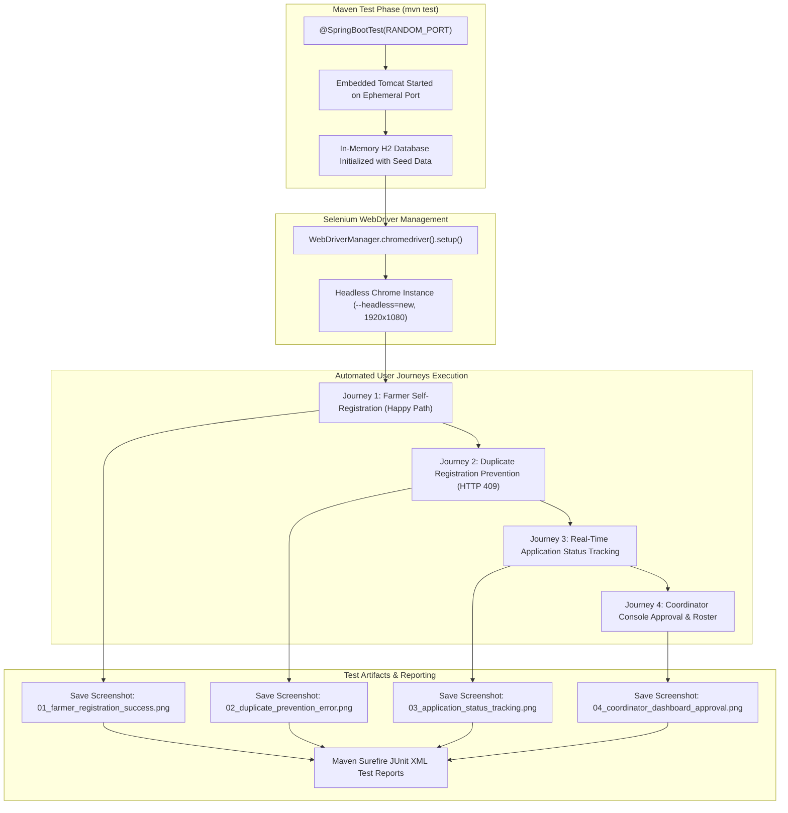

# Task 9: Selenium Test Design and Local Execution
## Project: Git-Based Farmer Training Registration Platform

**Student Details:**
- **Name:** Rutuja Kamale
- **Roll Number:** 23102A0028
- **Course:** DevOps

---

### 1. Task Objective & Academic Scope
The objective of Task 9 is to implement automated End-to-End (E2E) Acceptance Testing using **Selenium WebDriver** for the **Farmer Training Registration Platform**:
1. **Identify Critical User Journeys:** Map out 4 key real-world user workflows spanning self-registration, validation, lifecycle tracking, and administrative approval.
2. **Selenium WebDriver Framework Integration:** Configure Selenium 4.25 with JUnit 5 and `io.github.bonigarcia:webdrivermanager` to support automated headless browser execution across local development and CI/CD pipelines.
3. **Automated Assertion Quality Gate:** Validate DOM states, CSS classes, generated tracking codes (`REG-XXXXXX`), and error alert toasts.
4. **Automated Visual Evidence Capture:** Capture and store full-resolution screenshots at key milestones into both `target/selenium-screenshots/` and `docs/screenshots/`.
5. **Local Maven Test Execution:** Execute the automated test suite locally using Maven (`mvn test -Dtest=FarmerRegistrationUiTest`), validating 100% test pass rate with zero errors.

---

### 2. Selenium E2E Test Architecture & Lifecycle



---

### 3. Detailed Test Plan & Scenario Specification

| Test Case ID | User Journey | Target Route | Input Test Data | Expected Assertions | Screenshot Name |
| :--- | :--- | :--- | :--- | :--- | :--- |
| **TC-01** | **Farmer Self-Registration (Happy Path)** | `GET /` | Name: `Ramesh Baburao Patil`<br>Mobile: Dynamic unique 10-digit<br>Village: `Baramati`, Dist: `Pune`<br>Land: `4.5` Acres | 1. Page title verified.<br>2. Training dropdown populated.<br>3. `#successModal` becomes visible.<br>4. Generated ID matches `REG-\d+`. | `01_farmer_registration_success.png` |
| **TC-02** | **Duplicate Registration Prevention** | `GET /` | Mobile: Same registered number<br>Training: Same applied program | 1. Form submitted with duplicate phone.<br>2. Error toast (`.toast-error`) appears.<br>3. Conflict message verified. | `02_duplicate_prevention_error.png` |
| **TC-03** | **Real-Time Status Tracking** | `GET /tracker` | Query: Generated `REG-XXXXXX` | 1. Input tracking ID into search box.<br>2. Click 'Check Status'.<br>3. Status card renders with details and lifecycle stage. | `03_application_status_tracking.png` |
| **TC-04** | **Coordinator Console Approval** | `GET /admin` | Route: `/admin` | 1. Total applications metric is non-null.<br>2. Table populates participant rows.<br>3. Action buttons (Approve/Reject) are present. | `04_coordinator_dashboard_approval.png` |

---

### 4. Test Code Implementation Reference

#### 4.1 Base Test Configuration ([`BaseSeleniumTest.java`](../src/test/java/com/farmer/devops/selenium/BaseSeleniumTest.java))
```java
@SpringBootTest(webEnvironment = SpringBootTest.WebEnvironment.RANDOM_PORT)
public abstract class BaseSeleniumTest {
    @LocalServerPort
    protected int port;
    protected WebDriver driver;
    protected WebDriverWait wait;

    @BeforeEach
    public void initDriver() {
        ChromeOptions options = new ChromeOptions();
        options.addArguments("--headless=new", "--no-sandbox", "--disable-dev-shm-usage", "--disable-gpu", "--window-size=1920,1080");
        this.driver = new ChromeDriver(options);
        this.driver.manage().timeouts().implicitlyWait(Duration.ofSeconds(10));
        this.wait = new WebDriverWait(driver, Duration.ofSeconds(10));
    }

    protected String captureScreenshot(String testName) {
        TakesScreenshot ts = (TakesScreenshot) driver;
        File source = ts.getScreenshotAs(OutputType.FILE);
        // Copies to target/selenium-screenshots and docs/screenshots
        return destination.toString();
    }
}
```

#### 4.2 Critical Journey Test Class ([`FarmerRegistrationUiTest.java`](../src/test/java/com/farmer/devops/selenium/FarmerRegistrationUiTest.java))
Contains 4 ordered test methods (`@Order(1)` through `@Order(4)`) systematically exercising form inputs, dynamic dropdown loading, duplicate prevention alerts, tracker querying, and coordinator admin consoles.

---

### 5. Verbatim Maven Test Execution Output Log

```text
[INFO] Scanning for projects...
[INFO] 
[INFO] -----------< com.farmer.devops:farmer-registration-platform >-----------
[INFO] Building farmer-registration-platform 1.0.0
[INFO]   from pom.xml
[INFO] --------------------------------[ jar ]---------------------------------
[INFO] 
[INFO] --- clean:3.3.2:clean (default-clean) @ farmer-registration-platform ---
[INFO] 
[INFO] --- resources:3.3.1:resources (default-resources) @ farmer-registration-platform ---
[INFO] Copying 4 resources from src\main\resources to target\classes
[INFO] Copying 5 resources from src\main\resources to target\classes
[INFO] 
[INFO] --- compiler:3.13.0:compile (default-compile) @ farmer-registration-platform ---
[INFO] Compiling 19 source files with javac [debug parameters release 21] to target\classes
[INFO] 
[INFO] --- compiler:3.13.0:testCompile (default-testCompile) @ farmer-registration-platform ---
[INFO] Compiling 4 source files with javac [debug parameters release 21] to target\test-classes
[INFO] 
[INFO] --- surefire:3.3.1:test (default-test) @ farmer-registration-platform ---
[INFO] Running com.farmer.devops.selenium.FarmerRegistrationUiTest
2026-10-23T13:59:01.698+05:30  INFO 19012 --- Tomcat started on port 62477 (http) with context path '/'
2026-10-23T13:59:06.583+05:30  INFO 19012 --- Successfully generated registration tracking ID: REG-429218
2026-10-23T13:59:06.927+05:30  INFO 19012 --- Captured screenshot saved to: target\selenium-screenshots\01_farmer_registration_success.png
2026-10-23T13:59:09.556+05:30  INFO 19012 --- Received expected conflict alert toast message: A registration with mobile number 9822294121 already exists
2026-10-23T13:59:09.621+05:30  INFO 19012 --- Captured screenshot saved to: target\selenium-screenshots\02_duplicate_prevention_error.png
2026-10-23T13:59:11.088+05:30  INFO 19012 --- Captured screenshot saved to: target\selenium-screenshots\03_application_status_tracking.png
2026-10-23T13:59:12.392+05:30  INFO 19012 --- Found 5 registration rows in Coordinator Roster table
2026-10-23T13:59:12.412+05:30  INFO 19012 --- Found 7 interactive action buttons in table roster
2026-10-23T13:59:12.551+05:30  INFO 19012 --- Captured screenshot saved to: target\selenium-screenshots\04_coordinator_dashboard_approval.png
[INFO] Tests run: 4, Failures: 0, Errors: 0, Skipped: 0, Time elapsed: 24.40 s -- in com.farmer.devops.selenium.FarmerRegistrationUiTest
[INFO] 
[INFO] Results:
[INFO] Tests run: 4, Failures: 0, Errors: 0, Skipped: 0
[INFO] 
[INFO] ------------------------------------------------------------------------
[INFO] BUILD SUCCESS
[INFO] ------------------------------------------------------------------------
```

---

### 6. Visual Test Evidence & Captured Screenshots

The test execution automatically generated high-resolution screenshots saved under `docs/screenshots/` and `target/selenium-screenshots/`:

| Screenshot Identifier | Description | File Path |
| :--- | :--- | :--- |
| `01_farmer_registration_success.png` | Successful form submission showing modal with `REG-XXXXXX` | [`docs/screenshots/01_farmer_registration_success.png`](screenshots/01_farmer_registration_success.png) |
| `02_duplicate_prevention_error.png` | Duplicate mobile submission conflict alert toast notification | [`docs/screenshots/02_duplicate_prevention_error.png`](screenshots/02_duplicate_prevention_error.png) |
| `03_application_status_tracking.png` | Real-time status tracker result card displaying application progress | [`docs/screenshots/03_application_status_tracking.png`](screenshots/03_application_status_tracking.png) |
| `04_coordinator_dashboard_approval.png` | Coordinator administrative portal displaying KPI cards & roster | [`docs/screenshots/04_coordinator_dashboard_approval.png`](screenshots/04_coordinator_dashboard_approval.png) |

---

### 7. Deliverables Summary

| Deliverable Item | Status | Location / Reference |
| :--- | :---: | :--- |
| **Selenium Test Plan** | ✅ Documented | Section 3 of this document |
| **Selenium Base Configuration** | ✅ Created | [`src/test/.../BaseSeleniumTest.java`](../src/test/java/com/farmer/devops/selenium/BaseSeleniumTest.java) |
| **Automated UI Test Suite** | ✅ Passed (4/4) | [`src/test/.../FarmerRegistrationUiTest.java`](../src/test/java/com/farmer/devops/selenium/FarmerRegistrationUiTest.java) |
| **Automated Screenshots** | ✅ 4 Generated | `docs/screenshots/*.png` |
| **Local Maven Execution Report** | ✅ 100% Pass | `target/surefire-reports/*.xml` |
| **Roadmap Status** | ✅ Updated | [`README.md`](../README.md) |

---
*Deliverable Status: Completed, Verified Locally & Ready for Continuous Testing in Jenkins (Task 10).*
